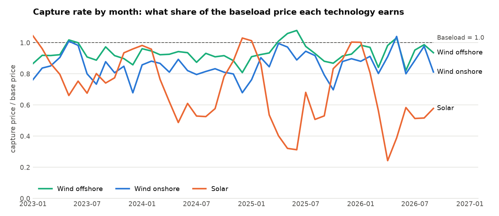

# ppa-lab: Renewable PPA Pricing & Risk Engine

What fixed price should a renewable producer offer an industrial buyer for ten
years of solar or wind output, and how much risk is left in that deal?

`ppa-lab` answers that question with public data and transparent methods. It
combines German power prices, generation and weather data, simulates them
together, and prices power purchase agreements (PPAs) with their market, shape
and volume risks.

> **Status: Day 3 of 14 (ticket PPA-3, version 0.3.0).** Done so far: the
> market-data foundation (Day 1), capture prices reconciled against the official
> German market values (Day 2), and the PPA structures with their pricing maths and a
> 2024-2025 back-test (Day 3, [methodology](METHODOLOGY.md)).
> See the [backlog](docs/BACKLOG.md) for what comes next.

## Day 3 results: what each PPA structure would have earned

A 50 MW solar park and a 30 MW wind park (national profiles, scaled) sign each contract
at the end of the previous year at last year's fair price, and deliver in 2024 and 2025.
Revenue per MWh produced; cash flows to the producer:

| EUR/MWh | Merchant | Pay-as-produced | PaP, no pay at negative prices | Baseload | Merchant + floor 0 |
|---|---|---|---|---|---|
| Solar 2024 | 46.48 | **72.25** | 59.04 | 63.14 | 49.26 |
| Solar 2025 | 45.95 | 46.48 | 35.22 | **35.14** | 49.25 |
| Wind 2024 | 64.54 | 78.44 | 73.50 | **81.20** | 65.03 |
| Wind 2025 | **77.27** | 64.54 | 59.63 | 66.46 | 77.71 |

- **A pay-as-produced PPA removes all price surprise** (realised minus the expectation at
  signing is 0.00 in every case); whether it beats merchant is hindsight.
- **A baseload PPA hedges the price level, not the shape:** on the solar park in 2025 it
  fell 11.34 EUR/MWh short of plan, worse than merchant, and produced a negative month.
- **A negative-price clause cost solar 11.26 EUR/MWh in 2025** (24% of the energy unpaid);
  the right to curtail at negative prices was worth 3.30 EUR/MWh.

Full report: [`reports/day03_ppa_structures.md`](reports/day03_ppa_structures.md);
the maths: [`METHODOLOGY.md`](METHODOLOGY.md).

## Day 2 results: what solar and wind really earn

The capture price is the energy-weighted price a technology earns:
sum(price x energy) / sum(energy) per quarter-hour. The capture rate divides it by the
baseload price.

| Capture rate (capture price, EUR/MWh) | 2023 | 2024 | 2025 | 2026 (Jan-Sep) |
|---|---|---|---|---|
| Baseload price | 95.18 | 78.51 | 89.32 | 107.72 |
| Solar | 0.76 (72.25) | 0.59 (46.48) | 0.51 (45.95) | 0.52 (55.68) |
| Wind onshore | 0.82 (78.44) | 0.82 (64.54) | 0.87 (77.27) | 0.89 (95.37) |
| Wind offshore | 0.91 (86.56) | 0.91 (71.40) | 0.96 (85.53) | 0.94 (101.65) |
| Solar energy sold at negative prices | 8.3% | 18.3% | 24.2% | 22.8% |

- **Solar cannibalisation:** in two years solar's capture rate fell from 0.76 to 0.51.
  In 2025 German solar earned EUR 3.0 billion less than the same energy at baseload.
- **Reconciliation with the official market values** (netztransparenz.de, legally the
  same formula): solar matches within 0.03 ct/kWh in 2023-2024 and 0.09 ct/kWh in
  2025 (tolerance ±0.10, fixed in advance). The spot price matches in 43 of 44 months.
  The one exception is June 2024, caused by the SDAC partial decoupling on
  26 June 2024.
- **Open investigation:** wind capture prices are 0.16 to 0.49 ct/kWh above the official
  values in every year. The evidence points to curtailment in the measured generation
  data versus the TSOs' online extrapolation. These references are deliberately left
  outside tolerance until that is tested (backlog PPA-2b).



Full report: [`reports/day02_capture_prices.md`](reports/day02_capture_prices.md).
How it was built and investigated:
[learning track, Day 2](docs/learning_track/day02_capture_prices.md).

## Day 1 results

| DE-LU day-ahead | 2023 | 2024 | 2025 | 2026 (Jan-Sep) |
|---|---|---|---|---|
| Mean price (EUR/MWh, time-weighted) | 95.18 | 78.51 | 89.32 | 107.72 |
| Hours with negative prices | 301 | 457 | 576 | 471 |
| Longest negative streak (hours) | 36 | 18 | 20 | 18 |
| Lowest / highest price (EUR/MWh) | -500.00 / 524.27 | -135.45 / 936.28 | -250.32 / 583.40 | -499.99 / 747.10 |

Reconciliation: the 2023 and 2025 mean prices match the official values exactly
(2024 differs by −0.95 EUR/MWh, fully explained by the 26 June 2024 decoupling), and the
negative-hour counts match published figures within 2 hours. Data quality: 23 checks pass,
1 warning (one real interval at the -500 EUR/MWh floor), 0 failures; all 1,369 delivery
days complete.

The full numbers, the data-quality report and four charts are in
[`reports/day01_market_data.md`](reports/day01_market_data.md).

## Quickstart

```bash
make setup     # create .venv and install the project with dev tools
make test      # 115 offline tests, about 2 seconds
make all       # download data, build datasets, check quality, write all reports
```

Explore the data interactively in the playground notebook (one section per sprint day):

```bash
make notebook       # opens notebooks/ppa_lab_playground.ipynb in JupyterLab
```

Every dataset and column is described in the [data dictionary](docs/data_dictionary.md).

Or step by step with the command-line tool:

```bash
.venv/bin/ppa-lab fetch     # download monthly raw files (cached, rate-limit aware)
.venv/bin/ppa-lab build     # build processed Parquet datasets
.venv/bin/ppa-lab check     # data-quality checks; exit code 1 on failure
.venv/bin/ppa-lab report    # reports/day01_market_data.md + figures
.venv/bin/ppa-lab capture   # reports/day02_capture_prices.md + figures
.venv/bin/ppa-lab ppa       # reports/day03_ppa_structures.md + figures
```

The first download takes 10 to 15 minutes because the free API is rate limited;
later runs use the local cache and finish in seconds.

## Project structure

```
config/project.toml          every assumption in one place (market, dates, limits, references)
src/ppa_lab/
  config.py                  typed settings
  timeutils.py               UTC, daylight saving, mixed 60/15-minute resolution
  data/energy_charts.py      API client (timeouts, retries, Retry-After) + pure parsers
  data/store.py              raw cache: monthly Parquet + manifest (checksum, licence)
  data/pipeline.py           fetch months, build processed datasets
  data/quality.py            data-quality checks (DST-aware completeness, price limits, physics)
  analysis/reconcile.py      annual statistics and tie-out against published figures
  analysis/day01_report.py   Day 1 report and charts
  analysis/capture.py        capture prices and rates, official market-value comparison
  analysis/day02_report.py   Day 2 report and charts
  analysis/plotting.py       shared chart style
  analysis/day03_report.py   Day 3 report and charts
  pricing/contracts.py       cash flows of every PPA structure, fair prices, discounting
  pricing/backtest.py        historical back-test: parks, prior-year strikes, plan and surprise
  cli.py                     `ppa-lab` command
tests/                       offline tests with real API fixtures
notebooks/                   ppa_lab_playground.ipynb: interactive, one section per day
data/reference/              small published reference data (official market values)
exercises/                   hands-on exercises with automatic checks
METHODOLOGY.md               the pricing maths, conventions, assumptions and limitations
docs/decisions/              architecture decision records (ADRs)
docs/learning_track/         day-by-day explanations of what was built and why
reports/                     generated reports and figures
scripts/build_docs.py        learning-track Markdown -> PDF (`make docs`)
```

## Data sources and licence

- Day-ahead prices and generation: **CC BY 4.0, Bundesnetzagentur | SMARD.de, via
  [Energy-Charts](https://energy-charts.info) (Fraunhofer ISE)**.
- Official market values (Marktwerte): the German TSOs, published on
  [netztransparenz.de](https://www.netztransparenz.de), stored in
  `data/reference/` for reconciliation.
- Code: MIT licence (see `LICENSE`). The licence does not cover downloaded data.

## Methodology notes

- Timestamps are stored in UTC at the start of each delivery interval
  ([ADR 0002](docs/decisions/0002-utc-storage-native-resolution.md)).
- Day-ahead prices are hourly until 30 Sep 2025 and quarter-hourly from 1 Oct 2025;
  averages are time-weighted across both.
- "Negative hours" means hours whose average price is below zero; two alternative
  definitions are reported because publishers differ.
