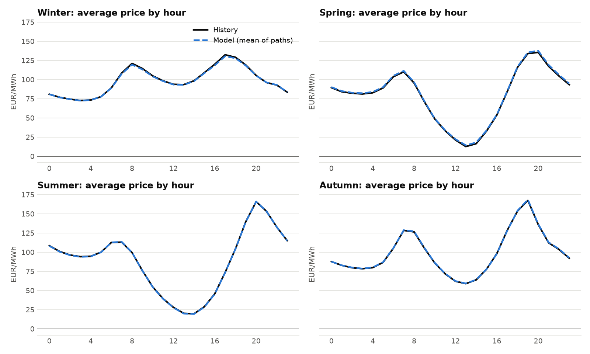
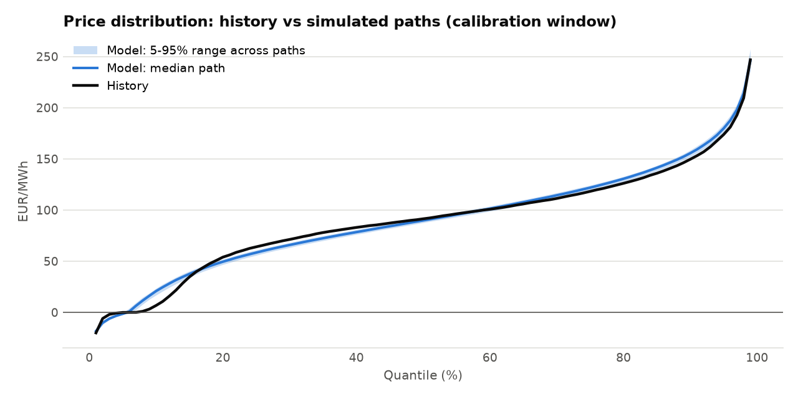
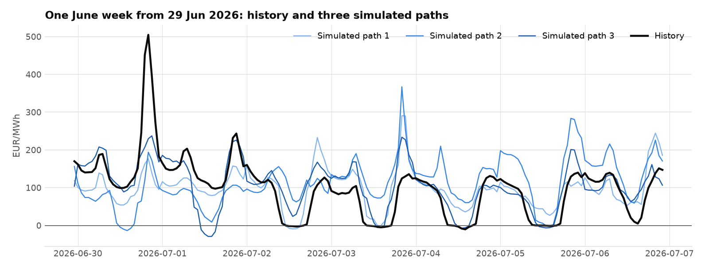

# Step 5: A stochastic price model (ticket PPA-5)

> **Numbers on this page (update for v1.1).** This page was written with the illustrative
> forward of 85 EUR/MWh (v1.0). Since v1.1 the model uses the market forward curve (EEX Cal-27
> base 140.21 EUR/MWh on 9 Oct 2026, Cal-28 104.75, Cal-29 87.58; see
> [Step 8, section 4.6](step08_hedging.md#46-update-v11-the-forward-is-now-the-markets)), so
> prices and fair prices are higher. The methods and lessons are unchanged; current numbers
> are in the reports and the README, and the exercise checks use the current data.

> **Time needed:** about 5 hours. Concepts take 90 minutes, code tour and findings
> 60 minutes, hands-on, notebook and exercises 2 hours, to-dos 30 minutes.
> **You will be able to:** explain why a PPA needs simulated prices and not only history,
> build a seasonal, mean-reverting price model in a transformed space, calibrate it to a
> forward price, and judge a stochastic model honestly by comparing distributions, not
> single paths.

**Contents:** [0. Scenario](#0-the-scenario) ·
[1. Concepts](#1-concepts-you-need-today) ·
[2. Architecture](#2-what-was-built-architecture) ·
[3. Code tour](#3-code-tour) ·
[4. Findings](#4-five-real-findings) ·
[5. Hands-on](#5-hands-on-run-it-yourself) ·
[6. Results](#6-results-what-the-model-says) ·
[7. Exercises](#7-exercises) ·
[8. Quiz](#8-self-check-quiz) ·
[9. Interview](#9-interview-corner) ·
[10. Real work](#10-how-this-maps-to-real-work-at-encavis) ·
[11. To-dos](#11-your-to-dos-for-step-5) ·
[12. Glossary](#12-glossary) ·
[13. Sources](#13-sources)

---

## 0. The scenario

Friday. The head of origination forwards an e-mail from the buyer:

> *"Thanks for the back-test. But we are signing for 2027 onwards, not for 2024. The
> forward for 2027 is about 85 EUR/MWh. What range of outcomes should we expect around
> that, and how often will the solar park produce into negative prices? We need a
> distribution, not one historical year. Ticket PPA-5."*

Steps 2 to 4 priced the parks against **history**: one path of prices that will never
repeat. A contract for a future year needs **many plausible price years** that agree with
what the market expects today (the forward) and behave like real prices: the same daily
shape, the same spikes and negative hours, and the same memory from one day to the next.
That is a stochastic price model. Step 6 will run it together with the 31 weather years
from Step 4.

**Ticket PPA-5: acceptance criteria (all met today)**

- [x] A calendar in local time: hour, season and day type, including the nine nationwide
      German holidays (Easter computed, not looked up).
- [x] A model in transformed space: monthly levels, daily shape, a mean-reverting daily
      factor, and intraday patterns taken from whole historical days.
- [x] Parameter recovery on synthetic prices with known parameters, including a known
      estimator bias.
- [x] The level calibrated to a forward price, with optional uncertainty about the level.
- [x] Validation against history (distribution, negative hours, autocorrelation), with the
      remaining gaps written down.
- [x] Parameters saved for Step 6 (`price_model.json`), `ppa-lab prices`, report, learning
      page, notebook section, exercises.

---

## 1. Concepts you need today

### 1.1 Why simulate prices at all?

A PPA's value is an **expectation over futures that have not happened**. History gives you
one sample of that future. With one sample you can compute an average but not a
**distribution**: no P10 revenue, no probability of a loss, no value of a floor in a bad
year. A stochastic model produces thousands of price years, each a plausible future.

Two sources of information go into it, and it matters which one sets what:

| Comes from the **market** (forward price) | Comes from **history** (calibration window) |
|---|---|
| The level: what one MWh of baseload in 2027 costs | The shape: midday dip, evening peak, weekends |
| | How strongly prices move from day to day, and how fast they return |
| | Spikes, negative hours, the intraday patterns |

This split is standard in PPA valuation: the market tells you **where** prices are
expected, history tells you **how** they move around that level. (In textbook language:
the level is market-implied, the dynamics are estimated under the real-world measure.)

### 1.2 The arcsinh transform

Models are easier to fit when the data look roughly symmetric and their spread does not
depend on the level. Raw prices are neither: most hours sit between 0 and 150 EUR/MWh,
a few spike to several hundred, and some are negative. The logarithm would tame the
spikes but cannot take a negative price. The **inverse hyperbolic sine** can:

    y = arcsinh(P / s)        P = s · sinh(y)

| P (EUR/MWh) | −100 | −10 | 0 | 10 | 50 | 120 | 250 | 500 | 2000 |
|---|---|---|---|---|---|---|---|---|---|
| y with s = 120 | −0.758 | −0.083 | 0 | 0.083 | 0.405 | 0.881 | 1.480 | 2.134 | 3.507 |

Near zero it is almost linear (y ≈ P/s), for large prices it grows like a logarithm
(arcsinh(x) ≈ ln 2x), and it is symmetric: a −100 hour is as far from zero as a +100
hour. The **scale s** decides where "large" starts: a small s compresses ordinary prices
too, a large s leaves spikes almost untouched. In Step 5 s was chosen by validation
(section 4.3): s = 120 EUR/MWh.

> **Pitfall:** the transform is not linear, so the average of transformed prices, turned
> back, is not the average price. That matters as soon as you calibrate to a forward
> (section 1.6).

### 1.3 Seasonality in three layers

In transformed space the model is

    y_t = L_month + S_(season, day type, hour) + D_day + u_t

The first two terms are deterministic (known in advance for every hour of 2027):

- **L, the monthly level.** One number per calendar month of the calibration window. It
  takes out the slow moves (gas and CO2 prices, the season) so they are not mistaken for
  short-term randomness. For a future year L = annual level + the average monthly shape.
- **S, the daily shape**, by season (winter, spring, summer, autumn), **day type** and local
  hour. Day types: working day, Saturday, and Sunday or public holiday (demand is similar on
  both). S carries the midday solar dip, the morning and evening peaks, and how much
  shallower all of that is on a Sunday.
- **Holidays.** The nine nationwide ones: New Year, Good Friday, Easter Monday, 1 May,
  Ascension, Whit Monday, 3 October, 25 and 26 December. Four of them move with Easter,
  which is computed with the anonymous Gregorian algorithm. Regional holidays such as
  Corpus Christi are left out (smaller effect on national demand).

Months and day types overlap: a month with five Sundays looks cheaper than one with four.
The fit therefore **back-fits**: estimate the levels, then the shape on what is left, then
the levels again on what the shape leaves, three times in total.

### 1.4 Mean reversion: AR(1), Ornstein-Uhlenbeck, half-life

What is left after the deterministic part is the day's own level D: a windy, a calm, a
cold day. Such deviations do not last: weather systems pass in days. The simplest model
with this property is the **AR(1)** process across days:

    D_d = φ · D_(d−1) + σ_season · z_d,        z_d ~ N(0, 1)

It is the discrete version of the **Ornstein-Uhlenbeck** process dX = κ(θ − X)dt + σ dW,
with φ = e^(−κ·Δt). Three numbers describe it:

- **φ, the persistence.** The share of today's deviation still there tomorrow. Here
  φ = 0.521: after one day 52% is left, after three days 14%, after a week 1%.
- **The half-life**, ln 2 / −ln φ: the time until half of a shock has gone. Here **1.06 days**.
- **The long-run spread.** If the process runs for a long time its variance settles at
  σ² / (1 − φ²). A simulation must **start** at that spread, not at zero, or every simulated
  year begins with an unnaturally calm January (Exercise 2).

σ depends on the season: autumn days scatter most (0.174 in transformed units), summer
days least (0.117).

### 1.5 Intraday patterns: resample whole days

A daily level is not enough: what happens *within* a day is what a solar PPA earns or loses.
A sunny spring Sunday has a midday trough far deeper than the average shape S, a dull
winter weekday almost none. Writing down how the 24 hours move together would need a
24 × 24 covariance per season, and it would still miss the shape of real troughs.

The model takes a shortcut that keeps every real feature: for each simulated day it draws
**one whole historical day of the same season** and uses that day's **pattern** u (its 24
hourly deviations from its own daily mean) **together with that day's standardised daily
shock** z. A deep midday dip therefore comes with the low daily level it had in reality,
and the 24 hours of a day stay consistent. This is a **bootstrap**: the empirical
distribution is the model. The pool holds 998 complete historical days (210 to 276 per
season).

> **Real-world note:** "historical simulation" of intraday shapes is common in utilities
> for exactly this reason. Its limit is the pool: a pattern that never happened in the
> calibration window cannot be simulated.

### 1.6 Calibrating to a forward price, and Jensen's inequality

For 2027 the market says 85 EUR/MWh. The model must reproduce that **average**. The obvious
guess, setting the level to arcsinh(85 / s), is wrong: sinh is convex for positive values,
so the average of s · sinh(level + noise) is **higher** than s · sinh(level) (Jensen's
inequality). With the 2025 pattern and s = 120 the naive level gives an average of about
89.5 EUR/MWh instead of 85 (Exercise 3; with s = 80 it would be 92.3).

`calibrate_level` therefore searches the level by **bisection**: the average simulated price
rises monotonically with the level, so halving an interval converges quickly. It uses the
**same random numbers** as the later `simulate` call (common random numbers), so the
calibrated paths average exactly the target.

The forward is the market's expectation, not a promise: the realised annual average of
2027 will differ. `level_volatility` adds one random shift of the level per path
(0.12 in transformed units, about ±18 EUR/MWh at one standard deviation around 85).

### 1.7 How to judge a stochastic model

A simulated path will never match the historical path hour by hour, and it should not.
The question is whether **history looks like one of the model's paths**. The procedure:

1. Simulate the calibration window itself (same calendar, same monthly levels), 200 paths.
2. For each statistic (mean, spread, quantiles, share of negative hours, autocorrelation at
   1, 24 and 168 hours) compute its value on every path.
3. Check whether history falls inside the **5-95% range across paths**.

A statistic outside the range is a known gap, and it goes into the report, not under the
carpet. Two warnings. In-sample validation is generous: the model saw this history.
And estimators of persistence are **biased** in short samples (Kendall's bias, section 4.2),
so a parameter-recovery test must expect the biased value, not the true one.

---

## 2. What was built: architecture

```
data/processed/prices_native.parquet ──► to_hourly ──► calibration window (config [price_model])
                                                                   │
prices/calendar.py   easter_sunday · german_holidays · calendar_features (hour, season, day type)
                                                                   │
prices/model.py      transform / inverse (arcsinh)                 ▼
                     fit(): monthly levels L + daily shape S (back-fit)
                            daily factor D: AR(1) across days (phi, sigma by season)
                            pool of whole days: season, z, 24-hour pattern u
                     PriceModel ─ save/load ─► data/processed/price_model.json  (Step 6 input)
                     simulate(): seasonal mean + D + u (+ level shift) ─► paths x hours, EUR/MWh
                     calibrate_level(): bisection to the forward, common random numbers
                                                                   │
prices/validation.py price_statistics · autocorrelation · compare_with_history
                                                                   ▼
analysis/step05_report.py ─► reports/step05_price_model.md + 3 charts      (`ppa-lab prices`)
```

---

## 3. Code tour

### 3.1 `prices/calendar.py`: the calendar is local

Everything that shapes demand happens in **local** time: people start work at 8:00 in
Berlin, not at 6:00 UTC in summer. `calendar_features(index, tz)` converts a UTC index to
local time and returns hour, month, season, day type and year. `german_holidays(year)`
builds the nine dates from `easter_sunday(year)`; the tests check Easter 2024, 2025 and
2026 against the published dates and every holiday of 2025.

### 3.2 `prices/model.py`: `fit`

`fit(prices, tz, scale)` transforms the prices, back-fits the monthly levels and the daily
shape, and then works on **days**: the daily mean of what is left is D, its AR(1) gives φ
(using only pairs of days exactly one day apart, so gaps in the data cannot fake
persistence), the shocks give σ per season, and every complete 24-hour day goes into the
pool with its season, its standardised shock z and its pattern u. The result is a
`PriceModel` dataclass that saves to and loads from plain JSON: Step 6 reads it without
re-fitting.

### 3.3 `simulate` and `calibrate_level`

`simulate(model, index, tz, n_paths, annual_level, seed, level_volatility)` returns a
matrix **paths × hours** in EUR/MWh: seasonal mean + daily factor + pattern of the drawn
day + (optionally) a level shift, transformed back. Two independent random streams are
spawned from one seed (`numpy.random.SeedSequence.spawn`): one for the days and shocks, one
for the level shift. That is what lets `calibrate_level` reuse exactly the residuals of a
later `simulate` call with the same seed. A daily factor that is not bootstrapped (Gaussian
shocks) is available for tests (`bootstrap=False`).

### 3.4 `prices/validation.py`

Three small functions: `price_statistics` (mean, spread, five quantiles, negative share),
`autocorrelation` (averaged over paths), and `compare_with_history`, which builds the table
of section 6.2 with the 5-95% range and an `inside_range` flag.

### 3.5 `analysis/step05_report.py` and `ppa-lab prices`

The report fits on the configured window, saves the parameters, validates in-sample with
200 paths, calibrates and simulates the delivery year with 500 paths, and prices the solar
park's 2025 weather year with those paths (the Step 6 teaser). `ppa-lab all` now ends with
this step and skips it (with a warning) when the configured range is too short.

### 3.6 Tests: what each one protects

| Test file | Protects against |
|---|---|
| `test_price_calendar.py` (3) | a wrong Easter date; missing or extra holidays; day types in UTC instead of local time |
| `test_price_model.py` (17) | a transform that fails on negative prices; half-life maths (including φ ≤ 0 and φ ≥ 1); AR(1) pairs across gaps; failure to recover a known daily shape, φ and σ from synthetic prices; a simulation that starts calm; days not resampled whole; a level that misses the forward; level volatility without effect; irreproducible paths; JSON round trip |
| `test_step05_report.py` (1), `test_config.py` (+1), `test_cli.py` (+1) | the report end to end; a calibration window outside the data; `ppa-lab prices` and `all` |

Every key test was checked by planting the bug it protects against (for example: start the
daily factor at zero, use pairs across gaps, skip the bisection) and watching it fail.

---

## 4. Five real findings

### 4.1 Version 1 failed its own validation

The first model was the textbook one: a single **hourly** AR(1) on the deseasonalised
transformed prices. It fitted well and failed validation clearly:

| Statistic | History | Version 1 (hourly AR(1), s = 30 to 80) | Version 2 (today, s = 120) |
|---|---|---|---|
| Autocorrelation at 24 hours | 0.700 | 0.38 to 0.54 | 0.593 |
| Share of negative hours | 6.2% | 3.5% to 4.0% | 4.9% |
| Half-life | | about 9-10 hours | 1.06 days |

An hourly process with a half-life of ten hours has **forgotten yesterday by this morning**.
Real prices remember: a windy day is usually followed by another windy day. The fix was
structural, not a parameter tweak: model the **day** as the unit of persistence and take
the hours within a day from real days. Version 2 closed most of the gap. The version note
is in the docstring of `prices/model.py`.

> **Interview:** "My first model passed its unit tests and failed validation. The
> validation table told me *what* was wrong (no memory across days), which pointed to the
> structural fix."

### 4.2 The estimator is biased, and the test knows it

The parameter-recovery test builds three years of synthetic prices with a known daily φ of
0.7. The fit returned about 0.60, consistently. The code was fine; the statistics explain it.
The monthly levels **demean** the daily factor in blocks of about 30 days, and an AR(1)
estimated on short demeaned blocks is biased downwards by about (1 + 3φ) / T (Kendall,
1954): (1 + 2.1) / 30.4 ≈ 0.10. The test now asserts the **bias-adjusted** value,
0.70 − 0.10 = 0.60, with a comment that shows the derivation.

On real data the same correction would turn φ = 0.521 into about 0.615 (half-life 1.42 days).
Tried as an experiment: the 24-hour autocorrelation improves a little (0.593 to 0.613), but
the weekly one gets worse and one more statistic leaves the range (7 to 6 inside). The
estimated φ stays. The missing memory is elsewhere (section 4.4).

A second wrong expectation in the same test: the correlation between the seasonal mean and
the synthetic prices was first asserted to be above 0.8. Working it out (shape variance
0.125, daily factor variance 0.078, hourly noise 0.01) gives √(0.125 / 0.213) = 0.77. The
test was wrong, not the code: derive expectations, don't guess them.

### 4.3 The scale: a grid that stopped at its edge

The first comparison tried s = 30, 50 and 80 and picked 80. Writing this page, the search
was extended:

| s (EUR/MWh) | 30 | 50 | 80 | **120** | 150 | 200 | 300 |
|---|---|---|---|---|---|---|---|
| Statistics inside the 5-95% range (of 11) | 1 | 2 | 5 | **7** | 7 | 7 | 7 |
| 1% quantile (history −20.1) | −28.3 | −33.1 | −37.7 | **−41.4** | −43.2 | −45.1 | −47.1 |
| Negative hours (history 6.2%) | 4.2% | 4.4% | 4.6% | **4.9%** | 5.0% | 5.1% | 5.2% |
| Autocorrelation 24 h (history 0.700) | 0.554 | 0.577 | 0.589 | **0.593** | 0.593 | 0.592 | 0.589 |

The best value of the first grid was at its **edge**, which is a warning sign: the optimum
may lie beyond it. From 120 on, seven statistics fit (the 95% quantile and the weekly
autocorrelation join), and larger values only push the negative tail further out. 120 was
also the smallest value that kept 7 of 11 with a second random seed (110 dropped to 6). The
configuration now says s = 120, and the level volatility moved from 0.15 to 0.12 so that it
means the same in EUR/MWh.

> **Pitfall:** if your chosen parameter sits at the end of the range you tried, you have not
> finished searching.

### 4.4 What the model still gets wrong

Four statistics stay outside the range, and each has a reason:

1. **Negative hours: 4.9% vs 6.2%, and a 1% quantile of −41 vs −20.** Real negative prices
   pile up **just below zero**: once the price is negative, flexible renewables in direct
   marketing stop producing, and §51 EEG removes the market premium during negative-price
   periods. That is a soft floor. The symmetric transform knows nothing about it, so the
   model produces fewer hours just below zero and more deep ones: history has 4.6% of its
   hours between −10 and 0 EUR/MWh and 1.6% below −10; the model has 1.5% and 3.4%.
2. **Autocorrelation at 24 hours: 0.59 vs 0.70.** The daily level carries over, but the
   **pattern** of each day is drawn independently. In reality a sunny spell repeats deep
   midday dips several days in a row. Weather persistence is missing, and Step 6 adds it:
   each simulated day will take its pattern from the same historical day as its weather.
3. **Autocorrelation at 1 hour: 0.914 vs 0.921**, narrowly outside. Patterns from two
   different days meet at midnight, which creates small jumps that real prices do not have.
4. The **teaser** in the report shows the consequence for a solar PPA: section 6.4.

### 4.5 Small ones

- **A groupby by a MultiIndex object** returned a flat index of tuples; grouping by a list of
  arrays and naming the levels fixed it.
- **`half_life(φ)` crashed** with a math domain error for φ ≤ 0. A test for the edge cases
  came first (φ ≤ 0 reverts within one step, φ ≥ 1 never), then the fix.
- **A flaky test:** two tests shared one module-level random generator, so results depended
  on test order. Each synthetic series now has its own seed.
- **A report test assumed 0 < φ.** The synthetic market of the end-to-end test has pure
  noise days, where φ can be slightly negative; the test now checks −1 < φ < 1.
- **An exercise check that hid itself:** the Step 5 exercise checks first used a pytest
  fixture to run your simulation. An unsolved stub then showed up as an ERROR at setup,
  which the notebook's check runner did not display. The checks now call a cached helper
  inside each test, so ⏳ appears as expected.

---

## 5. Hands-on: run it yourself

```bash
cd ".../Encavis quantitative/ppa-lab"
make test                  # 167 offline tests
make prices                # fits, validates, simulates 2027 (a few seconds)
open reports/step05_price_model.md
make notebook              # Step 5 section: 5.1 to 5.7, then your solutions
```

In the notebook, play with 5.4 (forward, level volatility, any week of 2027) and 5.6 (the
scale). Then look at 5.7: the scatter plots are the reason for Step 6.

---

## 6. Results: what the model says

### 6.1 Calibration (2024-01-01 to 2026-09-30, 24,095 hours)

| Item | Value |
|---|---|
| Scale s | 120 EUR/MWh |
| Daily factor φ | 0.521 per day, half-life **1.06 days** |
| Daily shock σ by season | autumn 0.174, winter 0.149, spring 0.137, summer 0.117 |
| Pool of historical days | 998 (summer 276, spring 273, winter 239, autumn 210) |

### 6.2 Validation (200 paths over the calibration window)

| Statistic | History | Model (mean) | Model 5-95% | Inside? |
|---|---|---|---|---|
| Mean (EUR/MWh) | 90.4 | 90.6 | 88.2 to 92.8 | yes |
| Standard deviation | 57.6 | 56.0 | 54.0 to 58.2 | yes |
| 1% quantile | −20.1 | −41.4 | −46.7 to −35.6 | no |
| 5% quantile | −0.1 | 0.9 | −2.4 to 3.9 | yes |
| Median | 91.4 | 90.4 | 88.4 to 92.6 | yes |
| 95% quantile | 173.7 | 176.4 | 172.2 to 181.1 | yes |
| 99% quantile | 246.8 | 242.5 | 231.7 to 254.3 | yes |
| Share of negative hours | 6.2% | 4.9% | 4.3% to 5.4% | no |
| Autocorrelation, 1 hour | 0.921 | 0.914 | 0.910 to 0.919 | no |
| Autocorrelation, 24 hours | 0.700 | 0.593 | 0.570 to 0.617 | no |
| Autocorrelation, 1 week | 0.548 | 0.517 | 0.482 to 0.549 | yes |







### 6.3 Delivery year 2027 (forward 85 EUR/MWh, 500 paths)

| Item | Value |
|---|---|
| Average of all simulated hours | 84.9 EUR/MWh |
| Annual average per path, 5% / 50% / 95% | 55.9 / 84.2 / 117.5 EUR/MWh |
| Hourly prices, 1% / 99% quantile | −47.2 / 239.0 EUR/MWh |
| Share of negative hours | 5.7% |

### 6.4 What solar earns under these prices (the Step 6 teaser)

The solar park's 2025 output, priced with the simulated 2027 paths, earns a capture rate of
**0.612** (5-95%: 0.446 to 0.693). With the real 2025 prices it earned **0.555**. The
model knows the *average* midday dip, but not that **sunny days have cheaper middays**.
Within a month, the correlation between the park's daily output and the 11:00-15:00 price
is **−0.30** in reality and **0.00** in the model (5-95% over 500 paths: −0.08 to +0.09).
An independent price model therefore **overstates** what solar earns, here by about six
percentage points of capture rate.

### 6.5 Five stories

1. **Prices forget in about a day.** A windy day's price discount is half gone by the next
   day and almost entirely gone after four. Weather regimes, not hours, set the memory.
2. **The forward is not the outcome.** Around an 85 EUR/MWh forward, one simulated 2027 in
   twenty averages below 56 and one in twenty above 117. A fixed-price PPA moves exactly
   that risk from one party to the other.
3. **Negative prices are a feature, not an outlier.** About one hour in eighteen is
   negative in the model, one in sixteen in history. A pay-as-produced contract without a
   negative-price clause pays in many of them (Step 3).
4. **The transform choice matters.** Between s = 30 and s = 120 the number of statistics
   the model reproduces moves from 1 to 7. A modelling choice that looks technical changes
   the answer.
5. **Independence is optimistic for solar.** The model's capture rate is too high because
   sunshine and low prices are not linked yet. Any PPA price built on independent prices
   and volumes would be too generous to the seller of solar power.

### 6.6 What this means for pricing

- Prices for any future year now come with a distribution. Step 6 joins them with the 31
  weather years, Step 7 turns the result into risk measures (P10 revenue, CVaR).
- The weather link is not a refinement: section 6.4 shows that without it the solar capture
  rate is biased upwards.
- The forward is still an assumption (85 EUR/MWh). Step 8 brings market forwards.

---

## 7. Exercises

**Warm-up (in `exercises/step05_prices.py`, checked by `.venv/bin/pytest exercises -q`)**

1. **How fast do price levels revert?** φ and the half-life of the daily level in 2024,
   by hand.
2. **Simulate the daily factor** as an AR(1) that starts in its stationary state.
3. **The level for a forward**, by bisection, and how far the naive guess is off.
4. **Written:** why an independent price model overstates what solar earns, how the two
   validation misses relate to it, and what you would change first.

**Core**

5. **Bias correction (test first).** Write a test on synthetic data (φ = 0.7, monthly
   demeaning) that a corrected estimator recovers 0.7 within 0.03. Then apply it in `fit`
   behind a flag and compare the validation tables. Do you keep it? (Section 4.2 has one
   answer; reproduce it.)
6. **Block bootstrap.** Draw blocks of three consecutive historical days instead of single
   days. Does the 24-hour autocorrelation improve? What happens at the block boundaries?
7. **Where are the negative hours missing?** Share of negative hours by season and hour, in
   history and in the model. Which cells explain most of the 1.3-point gap?

**Stretch**

8. **A soft floor.** Replace the transform for negative prices by a steeper one (or add a
   point mass just below zero) and see whether the 1% quantile and the negative share both
   move into the range.
9. **Re-calibrate on 2025-2026 only.** Do φ, σ and the daily shape change? Which window
   would you defend for pricing 2027, and why?

<details>
<summary>Hints and solution sketches</summary>

1. `transform` the hourly prices of local 2024, `groupby(index.date).mean()`, subtract the
   monthly means, then the weekday means, and regress d_t on d_(t−1) without intercept.
   You should get φ ≈ 0.541 and a half-life of about 1.13 days (2025: 0.481, 0.95 days).
   Without the weekday step φ comes out lower: weekends are a pattern, not persistence.
2. First column from N(0, σ²/(1 − φ²)), then the recursion. With φ = 0.5, σ = 0.2 the
   variance is 0.0533 on every day, including the first.
3. Bisection on `mean(s · sinh(L + x)) − target`. For 85 EUR/MWh and the 2025 pattern:
   L ≈ 0.6305, against the naive arcsinh(85/120) = 0.6595, whose average is 89.5 EUR/MWh.
4. Capture rate = weighted average price over sunny hours / average price. In reality the
   sunniest hours of a month are also its cheapest; in an independent model they are
   average. The misses: too few negative hours (those cluster on sunny days) and too
   little day-to-day memory of patterns (sunny spells). First change: draw each day's
   pattern from the same historical day as its weather (Step 6).
5. Use (φ̂ + 1/T) / (1 − 3/T) with T the average block length.
6. Draw a start day, take it and the next two days of the pool when they are consecutive.
7. Group `paths < 0` and `history < 0` by `calendar_features(...)[["season", "hour"]]`.
8. Compare `np.quantile` of history between −10 and 0 with the model: history has a spike
   there.
9. `fit(hist.loc["2025":], TZ, 120.0)` and compare `model.profile` by season.

</details>

---

## 8. Self-check quiz

1. Why can a back-test on history not tell you the P10 revenue of a 2027 PPA?
2. Which part of the model comes from the forward, which from history?
3. Why arcsinh and not the logarithm? What does the scale s do?
4. What are the three deterministic layers of the model, and why is the fit iterated?
5. Define φ, the half-life and the stationary variance of an AR(1).
6. Why must a simulation start in the stationary state?
7. Why are intraday patterns resampled as whole days, together with the day's shock?
8. Why is the calibrated level not arcsinh(forward / s)?
9. How do you validate a stochastic model, and what does "inside the range" mean?
10. Why does an independent price model overstate the capture rate of solar?

<details>
<summary>Answers</summary>

1. History is one path; a P10 needs a distribution of outcomes, which needs many plausible
   futures consistent with today's forward.
2. The level from the forward; shape, volatility, persistence, spikes and negative hours
   from history.
3. Prices can be negative, so the log is undefined; arcsinh is linear near zero, log-like
   for spikes, and symmetric. s sets where "large" starts, i.e. how strongly spikes are
   compressed.
4. Monthly levels, daily shape by season × day type × hour, and the holiday calendar inside
   the day type. Months and day types overlap (five Sundays in a month), so levels and shape
   are estimated alternately until they settle.
5. φ: share of a deviation left after one step; half-life ln 2 / −ln φ; variance
   σ² / (1 − φ²).
6. Otherwise the first days of every simulated year have too little spread, which biases
   anything that depends on early-year prices.
7. To keep the real joint behaviour of the 24 hours (a deep dip with a low daily level)
   without modelling a 24 × 24 covariance.
8. sinh is convex, so the average of sinh(level + noise) exceeds sinh(level): Jensen's
   inequality. The naive level overshoots the forward (89.5 instead of 85 here).
9. Simulate the calibration window many times, compute each statistic per path, and check
   whether history lies within the 5-95% range across paths.
10. In reality sunny hours are cheap hours; in the model solar output and prices are
    independent, so solar is paid the average midday price instead of the depressed one.

</details>

---

## 9. Interview corner

**Your 60-second story (STAR):**

> *Situation:* to price a PPA for 2027 the buyer needed a distribution of outcomes around
> the 85 EUR/MWh forward, not one historical year. *Task:* build an hourly German price
> model that respects the forward and behaves like real prices. *Action:* I modelled prices
> in arcsinh space with monthly levels, a season-by-day-type daily shape, a daily
> mean-reverting factor and intraday patterns bootstrapped from whole historical days;
> I calibrated the level to the forward by bisection and validated against history
> statistic by statistic. *Result:* a half-life of about one day, history inside the
> simulated range for 7 of 11 statistics, and the remaining gaps explained: too few hours
> just below zero, and no link between weather and prices yet, which makes solar look
> about six capture-rate points better than it is.

**Likely questions and strong answers:**

- *"How would you model power prices for PPA valuation?"* Deterministic seasonality
  (level, daily and weekly shape, holidays) in a transformed space, a mean-reverting
  stochastic part, spikes or regimes if the use case needs them, calibrated to the forward
  curve, and for renewables linked to weather so that volume and price stay correlated.
- *"Why mean reversion?"* Prices are anchored by fundamentals (fuel costs, demand,
  capacity); weather-driven deviations fade within days. A random walk would let hourly
  prices drift without bound.
- *"How do you calibrate to a forward curve?"* Keep the model's shape and dynamics and solve
  for the level (per month or per year) so that the expected simulated price matches each
  forward; in a non-linear space that needs a numerical solve, because of Jensen.
- *"How do you know your model is good enough?"* Compare distributions, not paths: quantiles,
  negative share, autocorrelation, with a range across paths; then check what matters for
  the product, here the capture rate. Report what fails and why.
- *"What are its weaknesses?"* The soft floor at zero, no weather link yet, in-sample
  validation only, and a short calibration window from one market regime.

---

## 10. How this maps to real work at Encavis

| In this project | In a company |
|---|---|
| arcsinh, monthly levels, daily AR(1), bootstrapped days | Fundamental models (merit order, scenarios) and statistical hourly models; vendor curves |
| One illustrative forward (85 EUR/MWh) | The full EEX forward curve by month and quarter, plus long-term fundamental curves beyond the liquid years |
| Level volatility | Scenario sets (low/base/high) and implied volatilities of forward options |
| Validation table with 5-95% ranges | Model validation reports, back-testing, model risk sign-off |
| Price paths as a matrix saved for Step 6 | Monte Carlo engines feeding PPA valuation, PFC shaping, risk reports |
| Gaps written down in the report | Model limitations and compensating controls in the methodology document |

The preparation guide names exactly this skill set: stochastic modelling, mean reversion,
calibration, and explaining a model's limits to non-quants.

---

## 11. Your to-dos for Step 5

- [ ] Read sections 1 and 4. Compute by hand: with φ = 0.521, how much of a shock is left
      after two days (27%), and what is the half-life (1.06 days)?
- [ ] Run section 5; in the notebook, change `SCALE` in 5.6 and reproduce one column of the
      table in section 4.3.
- [ ] Exercises 1-4 in `exercises/step05_prices.py`; check them in "My solutions: Step 5".
- [ ] **Commit Step 5** (commands below).
- [ ] **German vocabulary of this step:** der Terminpreis (forward price), die Terminkurve, die
      Mittelwertrückkehr (mean reversion), die Halbwertszeit, die Saisonalität, das
      Tagesprofil, der Feiertag, der Brückentag, die Preisspitze, negative Strompreise, die
      Monte-Carlo-Simulation, der Preispfad, die Kalibrierung, die Verteilung, das Quantil,
      die Autokorrelation.
- [ ] Stand-up update: *"Yesterday: a stochastic hourly price model, calibrated to an 85 EUR/MWh
      forward and validated against 2024-2026; prices forget in about a day. Today: joint
      weather and price Monte Carlo (PPA-6). Blockers: none."*

Commit (check `git status` first: no `.env`, no ` M .env.example`):

```bash
cd ".../Encavis quantitative/ppa-lab"
git status --short
git add src tests exercises config reports docs notebooks METHODOLOGY.md README.md CHANGELOG.md Makefile pyproject.toml
git status --short
git commit -m "feat(prices): stochastic hourly price model, calibrated and validated (PPA-5)"
git push
gh run watch
```

---

## 12. Glossary

| Term | Meaning |
|---|---|
| Stochastic price model | A model that generates many random but plausible price paths |
| Price path | One simulated price for every hour of a period |
| arcsinh transform, scale s | y = arcsinh(P/s): linear near 0, logarithmic for spikes, defined for P < 0 |
| Seasonality | Patterns known in advance: month, hour, day type, holidays |
| Day type | Working day, Saturday, Sunday or public holiday |
| AR(1) | x_t = φ x_(t−1) + noise: today depends on yesterday only |
| Ornstein-Uhlenbeck | The continuous-time mean-reverting process behind AR(1) |
| Half-life | Time until half of a shock has faded: ln 2 / −ln φ |
| Stationary state | The long-run distribution a mean-reverting process settles into |
| Bootstrap | Resampling observed data instead of assuming a distribution |
| Forward price | Today's market price for delivery in a future period |
| Jensen's inequality | For convex f, the average of f(x) exceeds f of the average |
| Common random numbers | Using the same random draws in two calculations to compare them exactly |
| Kendall's bias | Downward bias of autocorrelation estimates in short (or demeaned) samples |
| Validation range | The 5-95% range of a statistic across simulated paths |

## 13. Sources

- Schwartz, E. (1997): The stochastic behavior of commodity prices: implications for
  valuation and hedging. *Journal of Finance* 52(3), 923-973.
- Lucia, J. and Schwartz, E. (2002): Electricity prices and power derivatives: evidence from
  the Nordic Power Exchange. *Review of Derivatives Research* 5, 5-50.
- Benth, F. E., Šaltytė Benth, J. and Koekebakker, S. (2008): *Stochastic Modelling of
  Electricity and Related Markets.* World Scientific.
- Weron, R. (2014): Electricity price forecasting: a review of the state-of-the-art with a
  look into the future. *International Journal of Forecasting* 30(4), 1030-1081.
- Uniejewski, B., Weron, R. and Ziel, F. (2018): Variance stabilizing transformations for
  electricity spot price forecasting. *IEEE Transactions on Power Systems* 33(2), 2219-2229.
- Kendall, M. G. (1954): Note on bias in the estimation of autocorrelation. *Biometrika*
  41(3/4), 403-404.
- Efron, B. and Tibshirani, R. (1993): *An Introduction to the Bootstrap.* Chapman & Hall.
- Meeus, J. (1991): *Astronomical Algorithms*, chapter on the date of Easter.
- Erneuerbare-Energien-Gesetz (EEG 2023), §51: no market premium during negative prices.
- Encavis preparation guide: stochastic modelling, mean reversion, calibration; interview
  question "How would you model power prices?".
