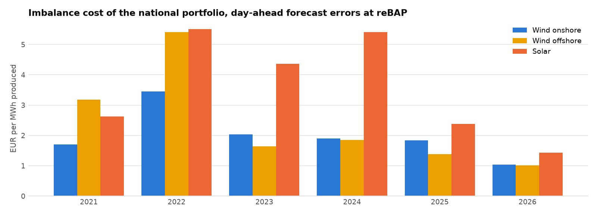

# Step 2b report: the TSOs' own data

Generated 2026-10-16 07:37 UTC by `ppa-lab balancing`.

Data: netztransparenz.de (reBAP, the TSOs' online extrapolation of
wind and solar output), ENTSO-E (day-ahead wind and solar forecasts for DE-LU), Energy-Charts
(measured output, day-ahead prices).

## 1. The official market values come from the TSOs' extrapolation (backlog PPA-2b)

Our capture prices with the measured feed-in (Energy-Charts) were above the official market
values, most for wind. The TSOs compute those values from their online extrapolation of the
output. With that extrapolation and our day-ahead prices the official monthly values are
reproduced (EUR/MWh, mean over the months of the year):

| Technology | Year | Measured feed-in − official | Online extrapolation − official |
|---|---|---|---|
| Solar | 2021 | −0.02 | +0.00 |
| Solar | 2022 | +0.07 | −0.00 |
| Solar | 2023 | +0.17 | +0.00 |
| Solar | 2024 | +0.02 | −0.19 |
| Solar | 2025 | +0.95 | +0.27 |
| Solar | 2026 | +3.41 | +1.05 |
| Wind offshore | 2021 | +1.95 | −0.00 |
| Wind offshore | 2022 | +7.20 | +0.00 |
| Wind offshore | 2023 | +5.43 | +0.00 |
| Wind offshore | 2024 | +4.36 | −0.40 |
| Wind offshore | 2025 | +5.06 | +0.00 |
| Wind offshore | 2026 | +7.01 | +0.01 |
| Wind onshore | 2021 | +1.52 | −0.00 |
| Wind onshore | 2022 | +4.61 | −0.00 |
| Wind onshore | 2023 | +2.39 | −0.00 |
| Wind onshore | 2024 | +1.81 | −0.71 |
| Wind onshore | 2025 | +2.65 | −0.00 |
| Wind onshore | 2026 | +6.55 | +0.06 |

Months with the extrapolation more than 1 EUR/MWh off: wind onshore 2024-06 (−8.53), wind offshore 2024-06 (−4.81), solar 2024-06 (−2.26), solar 2025-10 (+1.42), solar 2025-11 (+1.11), solar 2026-03 (+1.61), solar 2026-04 (+1.20), solar 2026-05 (+1.02), solar 2026-08 (+1.07). The annual values
(Jahresmarktwerte) the same way:

| Technology | Year | Official (EUR/MWh) | With the online extrapolation | Difference |
|---|---|---|---|---|
| Solar | 2025 | 45.08 | 45.21 | +0.13 |
| Solar | 2024 | 46.24 | 45.92 | −0.32 |
| Solar | 2023 | 72.00 | 72.00 | +0.00 |
| Solar | 2022 | 223.06 | 223.06 | +0.00 |
| Solar | 2021 | 75.52 | 75.52 | +0.00 |
| Wind onshore | 2025 | 74.41 | 74.41 | −0.00 |
| Wind onshore | 2024 | 62.93 | 62.49 | −0.44 |
| Wind onshore | 2023 | 76.21 | 76.21 | −0.00 |
| Wind onshore | 2022 | 162.72 | 162.72 | −0.00 |
| Wind onshore | 2021 | 78.54 | 78.54 | +0.00 |
| Wind offshore | 2025 | 80.59 | 80.59 | +0.00 |
| Wind offshore | 2024 | 67.77 | 67.48 | −0.29 |
| Wind offshore | 2023 | 81.87 | 81.87 | +0.00 |
| Wind offshore | 2022 | 183.49 | 183.49 | −0.00 |
| Wind offshore | 2021 | 90.17 | 90.17 | +0.00 |

The extrapolation counts more energy than the measured feed-in (TWh):

|   Year |   wind_onshore measured |   wind_offshore measured |   solar measured |   wind_onshore online |   wind_offshore online |   solar online |
|-------:|------------------------:|-------------------------:|-----------------:|----------------------:|-----------------------:|---------------:|
|   2021 |                    90.3 |                     24   |             45.3 |                  96.3 |                   26.1 |           46.9 |
|   2022 |                    97.2 |                     24.8 |             54.3 |                 108.8 |                   28.8 |           55.9 |
|   2023 |                   115.9 |                     23.5 |             53.9 |                 126.9 |                   29.6 |           56.1 |
|   2024 |                   110.6 |                     25.7 |             59.7 |                 119.2 |                   30.6 |           65.3 |
|   2025 |                   105.1 |                     26.1 |             70.1 |                 113.1 |                   30.3 |           77.4 |
|   2026 |                    77.7 |                     20.5 |             76.2 |                  85.5 |                   24   |           80.5 |

The measured feed-in lacks output curtailed in congested or negative hours, which are cheap: so
its capture price is higher. The difference of Step 2 is explained, not an error of ours.

## 2. What balancing costs

A direct marketer sells its day-ahead forecast at the day-ahead price and settles the rest at
the imbalance price reBAP. Per MWh produced, with each month's forecast scaled to the month's
actual energy (only timing and shape errors count):

| Year | Wind onshore: cost (EUR/MWh); forecast error | Wind offshore: cost (EUR/MWh); forecast error | Solar: cost (EUR/MWh); forecast error | Mean distance of reBAP from the day-ahead price (EUR/MWh) |
|---|---|---|---|---|
| 2021 | 1.70; 9.7% | 3.18; 15.6% | 2.63; 7.1% | 72.5 |
| 2022 | 3.45; 8.9% | 5.41; 16.0% | 5.50; 6.2% | 193.0 |
| 2023 | 2.04; 8.7% | 1.64; 20.7% | 4.37; 6.8% | 93.0 |
| 2024 | 1.90; 8.7% | 1.85; 19.4% | 5.41; 7.2% | 84.8 |
| 2025 | 1.84; 9.4% | 1.38; 16.7% | 2.38; 6.9% | 51.4 |
| 2026 | 1.04; 10.5% | 1.01; 16.5% | 1.43; 5.7% | 48.6 |

Forecast error: mean absolute error over mean output. The cost follows the distance of reBAP
from the day-ahead price more than the forecast quality, which hardly changed. Over the last 12
months (2025-10-01 to 2026-09-30, the analog pool of the 2027 scenarios):
wind onshore 1.05, wind offshore 1.09, solar 1.68 EUR/MWh (the 12 months
before: wind onshore 2.24, wind offshore 1.70, solar 2.56).

This is the national portfolio. A single park's forecast errors are larger, but a direct
marketer pools many parks and corrects part of its error intraday before delivery: the two
effects pull in opposite directions, so the national cost is a fair estimate for a large
marketer's pool. The cost assumptions of Step 7 (`[ppa.parks.*] balancing_eur_mwh`) are this
measured cost plus a marketing fee.

Results: `data/processed/balancing.json`.
