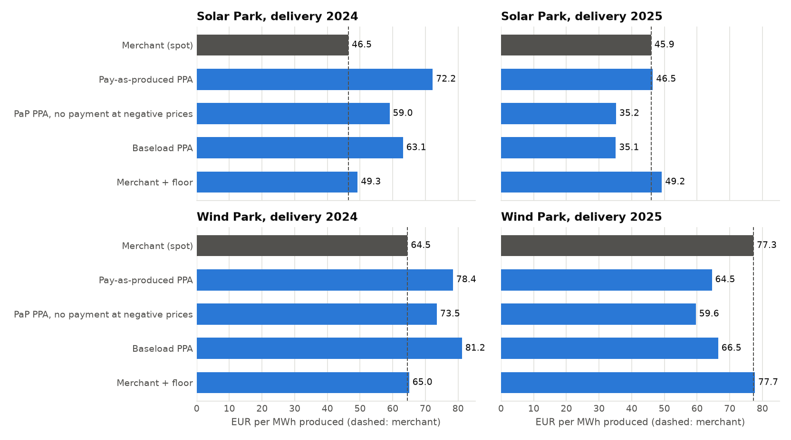
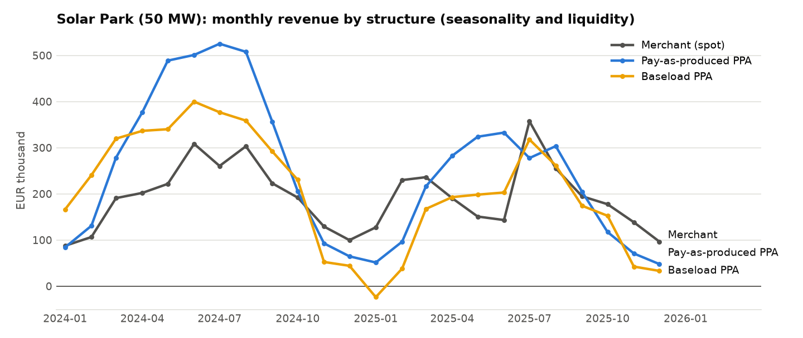

# Step 3 report: PPA structures back-tested

Generated 2026-10-14 07:00 UTC by `ppa-lab ppa`.
Data: CC BY 4.0 - Bundesnetzagentur | SMARD.de, via Energy-Charts (Fraunhofer ISE).
Delivery years: 2024, 2025.

**Set-up.** Each park uses the national generation profile of its technology, scaled to
capacity x full-load hours in every year. A contract for delivery year Y is signed at the
end of Y-1 at Y-1's fair price: the pay-as-produced strike is Y-1's capture price, the
baseload strike Y-1's base price, and the band delivers the expected annual energy flat.
That is a naive stand-in for forward prices. Cash flows are to the producer, per
quarter-hour, without option premiums, balancing or credit costs. Maths: `METHODOLOGY.md`.

**Plan and surprise.** The plan is what each structure would have earned per MWh had the
delivery year looked like the year before (same terms on last year's prices and profile):
the expectation at signing. Surprise = realised − plan is the risk each structure left with
the producer. The worst month shows liquidity: a baseload seller can have negative months.

## 1. Results per park

### Solar Park: 50 MW solar, 1000 full-load hours

Strikes, fixed at the end of the previous year:

|   Delivery year |   PaP strike (EUR/MWh) |   Baseload strike (EUR/MWh) |   Band (MW) |
|----------------:|-----------------------:|----------------------------:|------------:|
|            2024 |                  72.25 |                       95.18 |        5.69 |
|            2025 |                  46.48 |                       78.51 |        5.71 |

Results:

|   Year | Structure                              |   Revenue (EUR m) |   EUR/MWh |   vs merchant (EUR/MWh) |   Plan (EUR/MWh) |   Surprise vs plan |   Worst month (EUR k) |
|-------:|:---------------------------------------|------------------:|----------:|------------------------:|-----------------:|-------------------:|----------------------:|
|   2024 | Merchant (spot)                        |              2.32 |     46.48 |                    0    |            72.25 |             -25.77 |                    87 |
|   2024 | Pay-as-produced PPA                    |              3.61 |     72.25 |                   25.77 |            72.25 |               0    |                    65 |
|   2024 | PaP PPA, no payment at negative prices |              2.95 |     59.04 |                   12.56 |            66.25 |              -7.21 |                    65 |
|   2024 | Baseload PPA                           |              3.16 |     63.14 |                   16.66 |            72.25 |              -9.11 |                    44 |
|   2024 | Merchant + floor                       |              2.46 |     49.26 |                    2.79 |            74.13 |             -24.86 |                    87 |
|   2025 | Merchant (spot)                        |              2.3  |     45.95 |                    0    |            46.48 |              -0.53 |                    97 |
|   2025 | Pay-as-produced PPA                    |              2.32 |     46.48 |                    0.53 |            46.48 |               0    |                    48 |
|   2025 | PaP PPA, no payment at negative prices |              1.76 |     35.22 |                  -10.73 |            37.98 |              -2.76 |                    48 |
|   2025 | Baseload PPA                           |              1.76 |     35.14 |                  -10.81 |            46.48 |             -11.34 |                   -24 |
|   2025 | Merchant + floor                       |              2.46 |     49.25 |                    3.3  |            49.26 |              -0.02 |                    97 |

### Wind Park: 30 MW wind onshore, 2000 full-load hours

Strikes, fixed at the end of the previous year:

|   Delivery year |   PaP strike (EUR/MWh) |   Baseload strike (EUR/MWh) |   Band (MW) |
|----------------:|-----------------------:|----------------------------:|------------:|
|            2024 |                  78.44 |                       95.18 |        6.83 |
|            2025 |                  64.54 |                       78.51 |        6.85 |

Results:

|   Year | Structure                              |   Revenue (EUR m) |   EUR/MWh |   vs merchant (EUR/MWh) |   Plan (EUR/MWh) |   Surprise vs plan |   Worst month (EUR k) |
|-------:|:---------------------------------------|------------------:|----------:|------------------------:|-----------------:|-------------------:|----------------------:|
|   2024 | Merchant (spot)                        |              3.87 |     64.54 |                    0    |            78.44 |             -13.9  |                   160 |
|   2024 | Pay-as-produced PPA                    |              4.71 |     78.44 |                   13.9  |            78.44 |               0    |                   217 |
|   2024 | PaP PPA, no payment at negative prices |              4.41 |     73.5  |                    8.96 |            73.9  |              -0.4  |                   174 |
|   2024 | Baseload PPA                           |              4.87 |     81.2  |                   16.66 |            78.44 |               2.77 |                   252 |
|   2024 | Merchant + floor                       |              3.9  |     65.03 |                    0.49 |            78.91 |             -13.88 |                   166 |
|   2025 | Merchant (spot)                        |              4.64 |     77.27 |                    0    |            64.54 |              12.73 |                   230 |
|   2025 | Pay-as-produced PPA                    |              3.87 |     64.54 |                  -12.73 |            64.54 |               0    |                   210 |
|   2025 | PaP PPA, no payment at negative prices |              3.58 |     59.63 |                  -17.65 |            60.48 |              -0.85 |                   189 |
|   2025 | Baseload PPA                           |              3.99 |     66.46 |                  -10.81 |            64.54 |               1.92 |                   218 |
|   2025 | Merchant + floor                       |              4.66 |     77.71 |                    0.44 |            65.03 |              12.68 |                   231 |

## 2. What the numbers say

- **Solar Park, 2025:** merchant earned 45.95 EUR/MWh. Against that, the pay-as-produced PPA made +0.53 EUR/MWh and the baseload PPA -10.81 EUR/MWh. The negative-price clause cost the producer 11.26 EUR/MWh; a floor at 0 EUR/MWh (or curtailing below it) added +3.30 EUR/MWh. Surprise against plan: merchant -0.53, pay-as-produced +0.00, baseload -11.34 EUR/MWh.
- **Wind Park, 2025:** merchant earned 77.27 EUR/MWh. Against that, the pay-as-produced PPA made -12.73 EUR/MWh and the baseload PPA -10.81 EUR/MWh. The negative-price clause cost the producer 4.91 EUR/MWh; a floor at 0 EUR/MWh (or curtailing below it) added +0.44 EUR/MWh. Surprise against plan: merchant +12.73, pay-as-produced +0.00, baseload +1.92 EUR/MWh.

## 3. Charts

