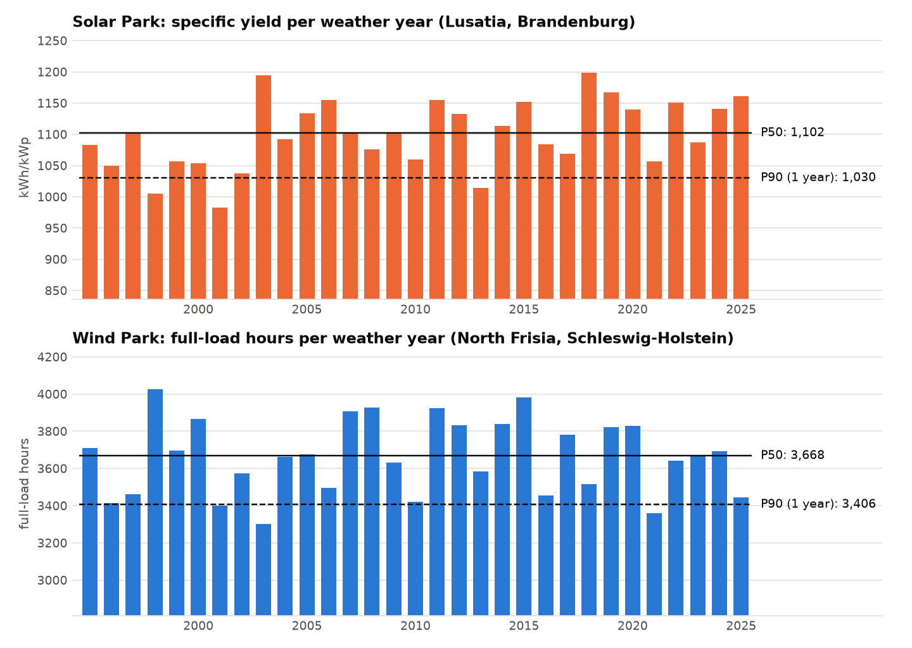
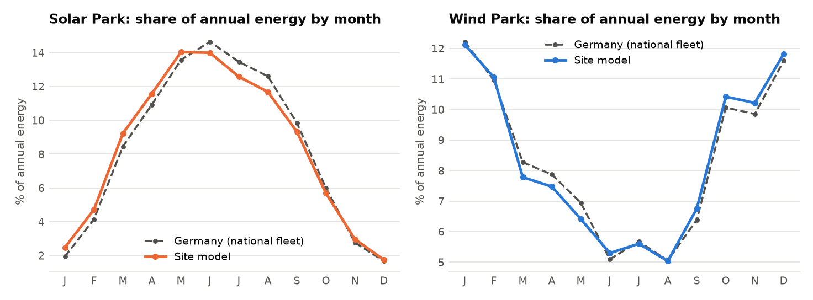

# Step 4 report: weather to power

Generated 2026-10-15 16:27 UTC by `ppa-lab weather`.
Weather: CC BY 4.0 - Open-Meteo.com; contains modified Copernicus Climate Change Service information (ERA5). Hourly ERA5 reanalysis per site; radiation converted from
end-of-hour to interval-beginning labels (checked against the sun's position).

## 1. The parks

| Park       | Site                                     | Requested        | ERA5 grid point        | Capacity     | Model                                                          |
|:-----------|:-----------------------------------------|:-----------------|:-----------------------|:-------------|:---------------------------------------------------------------|
| Solar Park | Borrentin, Mecklenburg-Western Pomerania | 53.81 N, 12.98 E | 53.75 N, 13.00 E, 39 m | 114 MWp (DC) | tilt_deg=25, azimuth_deg=180, dc_ac_ratio=1.2, losses_pct=12.4 |
| Wind Park  | Everswinkel, North Rhine-Westphalia      | 51.93 N, 7.84 E  | 52.00 N, 7.75 E, 70 m  | 28.5 MW      | turbine_type=E-126/4200, hub_height_m=164, losses_pct=26.4     |

## 2. Annual energy over the weather years (volume risk)

P50 = median weather year. P90 = energy exceeded in 90% of years (normal approximation,
mean − 1.2816 σ); for a 10-year average σ shrinks by √10.

|                                                | Solar Park                                         |
|:-----------------------------------------------|:---------------------------------------------------|
| Weather years                                  | 1995-2025 (31)                                     |
| P50 (median year)                              | 120.9 GWh = 1,061 kWh/kWp                          |
| Mean                                           | 120.5 GWh                                          |
| Year-to-year variability (std, CoV)            | 5.5 GWh (4.6%)                                     |
| P90, one year                                  | 113.4 GWh (-5.9% vs mean)                          |
| P90, 10-year average                           | 118.3 GWh (-1.9%)                                  |
| Worst / best year                              | 1998: 109.8 GWh (-8.9%) / 2018: 132.7 GWh (+10.2%) |
| Linear trend                                   | +2.1% per decade                                   |
| Published expectation (Step 3 full-load hours) | 121.0 GWh; model P50 -0.0%                         |

|                                                | Wind Park                                         |
|:-----------------------------------------------|:--------------------------------------------------|
| Weather years                                  | 1995-2025 (31)                                    |
| P50 (median year)                              | 64.0 GWh = 2,245 full-load hours                  |
| Mean                                           | 64.0 GWh                                          |
| Year-to-year variability (std, CoV)            | 4.6 GWh (7.2%)                                    |
| P90, one year                                  | 58.1 GWh (-9.2% vs mean)                          |
| P90, 10-year average                           | 62.1 GWh (-2.9%)                                  |
| Worst / best year                              | 2010: 55.4 GWh (-13.5%) / 1998: 72.7 GWh (+13.6%) |
| Linear trend                                   | -1.7% per decade                                  |
| Published expectation (Step 3 full-load hours) | 64.0 GWh; model P50 -0.1%                         |

## 3. Checks against national data

The site models are compared with national generation of the same technology (Step 1)
and priced with the same hourly day-ahead prices (capture rate as in Step 2).

| Park       |   Year |   Hourly correlation with national |   Capture rate, site |   Capture rate, national |   Site capture price (EUR/MWh) |
|:-----------|-------:|-----------------------------------:|---------------------:|-------------------------:|-------------------------------:|
| Solar Park |   2021 |                               0.91 |                0.776 |                    0.785 |                          75.2  |
| Solar Park |   2022 |                               0.93 |                0.934 |                    0.939 |                         219.96 |
| Solar Park |   2023 |                               0.92 |                0.799 |                    0.759 |                          76.06 |
| Solar Park |   2024 |                               0.92 |                0.601 |                    0.592 |                          47.22 |
| Solar Park |   2025 |                               0.92 |                0.542 |                    0.516 |                          48.38 |
| Wind Park  |   2021 |                               0.86 |                0.829 |                    0.834 |                          80.31 |
| Wind Park  |   2022 |                               0.88 |                0.703 |                    0.715 |                         165.6  |
| Wind Park  |   2023 |                               0.88 |                0.82  |                    0.824 |                          78    |
| Wind Park  |   2024 |                               0.86 |                0.818 |                    0.822 |                          64.26 |
| Wind Park  |   2025 |                               0.87 |                0.855 |                    0.865 |                          76.34 |

## 4. What the numbers say

- **Solar Park:** P50 1,061 kWh/kWp; one year in ten falls below -5.9% of the mean, the worst year (1998) was -8.9%; trend +2.1% per decade. Hourly correlation with the national fleet 0.91-0.93; capture rate site 0.731 vs national 0.718 (average of the check years).
- **Wind Park:** P50 2,245 full-load hours; one year in ten falls below -9.2% of the mean, the worst year (2010) was -13.5%; trend -1.7% per decade. Hourly correlation with the national fleet 0.86-0.88; capture rate site 0.805 vs national 0.812 (average of the check years).

## 5. Charts

