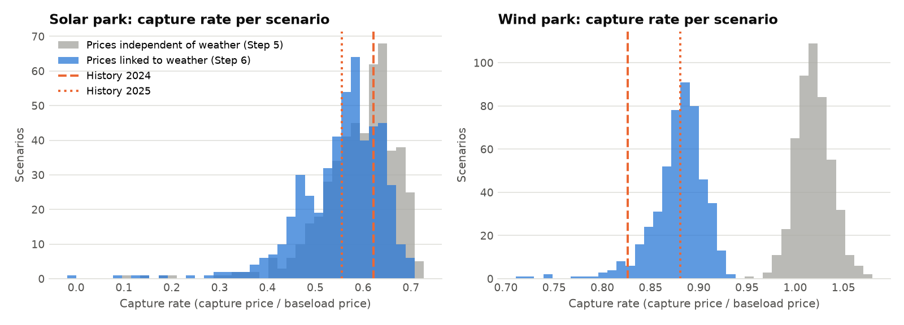
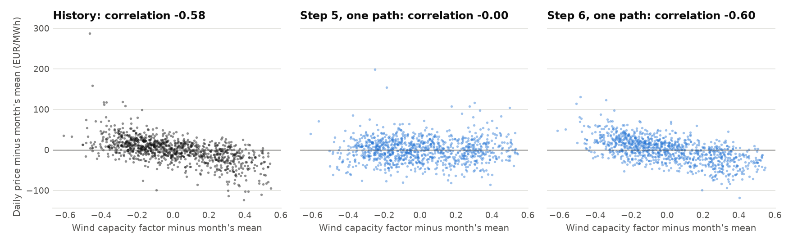
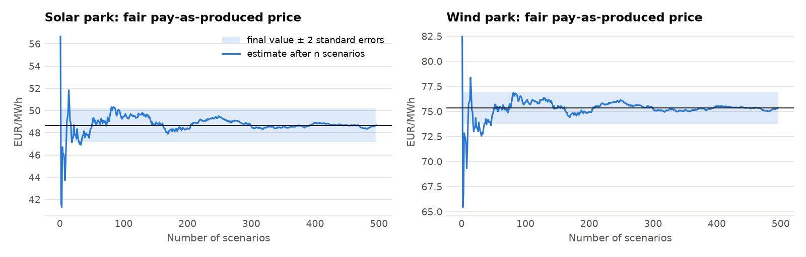

# Step 6 report: joint weather and price scenarios

Generated 2026-10-14 07:00 UTC by `ppa-lab scenarios`.

Data: CC BY 4.0 - Bundesnetzagentur | SMARD.de, via Energy-Charts (Fraunhofer ISE); ERA5 via Open-Meteo (CC BY 4.0 - Open-Meteo.com; contains modified Copernicus Climate Change Service information (ERA5)).

## 1. The weather-price link

The Step 5 model drew each simulated day at random from its season. Here the day's weather
decides: its level responds to the weather anomaly (regression per season on the solar and
wind capacity factors of the two parks and the temperature), and its hourly pattern comes
from one of the 10 historical days within ±30 days of the date whose
weather was closest (analog days). Calibration: 2024-01-01 to
2026-09-30, with the real weather of those days.

Response of the daily price level, in EUR/MWh at 85 EUR/MWh
(capacity factor CF: mean output / capacity):

| Season   |   R² |   +0.1 solar CF |   +0.1 wind CF |   +1 °C |
|:---------|-----:|----------------:|---------------:|--------:|
| autumn   | 0.54 |            -0.4 |           -8.3 |    -0.5 |
| spring   | 0.52 |           -11.7 |           -6   |    -0.3 |
| summer   | 0.56 |            -7.2 |           -6.4 |     1.1 |
| winter   | 0.44 |            -6.3 |           -5.6 |    -2.1 |

What weather does not explain still reverts with phi = 0.456 per day (half-life
0.88 days). Analog pool: 998 historical days.

## 2. Validation with the real weather of the calibration window

200 paths each; analog days at least 7 days away from the
simulated day (no peeking). Statistics with history inside the 5-95% range of the paths:
**Step 5: 7 of 11; Step 6:
6 of 11.**

| Statistic                 | History   | Step 5 (independent) (inside?)   | Step 6 (linked) (inside?)   |
|:--------------------------|:----------|:---------------------------------|:----------------------------|
| Mean (EUR/MWh)            | 90.4      | 90.6 (yes)                       | 91.4 (yes)                  |
| Standard deviation        | 57.6      | 56.0 (yes)                       | 57.2 (yes)                  |
| 1% quantile               | -20.1     | -41.4 (no)                       | -43.3 (no)                  |
| 5% quantile               | -0.1      | 0.9 (yes)                        | -0.4 (yes)                  |
| Median                    | 91.4      | 90.4 (yes)                       | 92.1 (yes)                  |
| 95% quantile              | 173.7     | 176.4 (yes)                      | 178.3 (no)                  |
| 99% quantile              | 246.8     | 242.5 (yes)                      | 245.7 (yes)                 |
| Share of negative hours   | 6.2%      | 4.9% (no)                        | 5.1% (no)                   |
| Autocorrelation, 1 hour   | 0.921     | 0.914 (no)                       | 0.916 (no)                  |
| Autocorrelation, 24 hours | 0.700     | 0.593 (no)                       | 0.621 (no)                  |
| Autocorrelation, 1 week   | 0.548     | 0.517 (yes)                      | 0.536 (yes)                 |

Capture rates of the parks in each complete year (median and 5-95% over paths):

|   Year | Park       |   History | Step 5 (independent)   | Step 6 (linked)     |
|-------:|:-----------|----------:|:-----------------------|:--------------------|
|   2024 | Solar park |     0.622 | 0.572 (0.530-0.607)    | 0.542 (0.513-0.568) |
|   2024 | Wind park  |     0.827 | 1.000 (0.978-1.023)    | 0.865 (0.845-0.883) |
|   2025 | Solar park |     0.555 | 0.617 (0.585-0.646)    | 0.575 (0.548-0.599) |
|   2025 | Wind park  |     0.881 | 1.021 (0.998-1.040)    | 0.893 (0.875-0.911) |

History outside the Step 6 range: solar park 2024 (0.622 vs 0.513-0.568), wind park 2024 (0.827 vs 0.845-0.883).

## 3. Delivery year 2027: 496 scenarios

31 weather years (1995-2025) x 16 price paths
= 496 scenarios; forward 85.0 EUR/MWh, level uncertainty
0.12. The same scenarios with prices independent of the weather
(Step 5 model) for comparison.

| Park       | Prices      |   Fair PaP price (EUR/MWh) | Capture rate 5/50/95%   | Revenue P10/P50/P90 (EUR m)   |   Corr(energy, baseload price) |
|:-----------|:------------|---------------------------:|:------------------------|:------------------------------|-------------------------------:|
| Solar park | independent |                      51.76 | 0.458 / 0.605 / 0.692   | 1.71 / 2.82 / 4.06            |                           0    |
| Solar park | linked      |                      48.66 | 0.404 / 0.570 / 0.661   | 1.52 / 2.67 / 3.90            |                          -0.03 |
| Wind park  | independent |                      87    | 0.990 / 1.018 / 1.050   | 6.97 / 9.55 / 12.49           |                           0.01 |
| Wind park  | linked      |                      75.35 | 0.830 / 0.883 / 0.915   | 5.88 / 8.23 / 10.95           |                          -0.12 |

- Ignoring the weather link overstates the fair pay-as-produced price by
  3.09 EUR/MWh (solar park) and 11.64 EUR/MWh (wind park).
- Monte Carlo standard error of the linked fair prices:
  solar park 0.75 EUR/MWh, wind park 0.80 EUR/MWh.
- Does the latest historical capture rate fall inside the linked range?
  Solar park: 2025 history 0.555, linked 5-95% 0.404 to 0.661 (inside); Wind park: 2025 history 0.881, linked 5-95% 0.830 to 0.915 (inside).

Per-scenario results: `data/processed/scenarios_2027.parquet` (input for Step 7).

### Sensitivity: which historical days represent 2027?

Intraday patterns come from the analog pool. Midday solar dips deepened year by year as
solar capacity grew, so the pool's period matters. The base case above uses the whole
calibration window (as in the validation).

| Analog days from            |   Days in pool |   Solar park: fair price |   Solar park: median capture rate |   Wind park: fair price |   Wind park: median capture rate |
|:----------------------------|---------------:|-------------------------:|----------------------------------:|------------------------:|---------------------------------:|
| 2024-01-01 (whole window)   |            998 |                    48.66 |                             0.57  |                   75.35 |                            0.883 |
| 2025-01-01 (2025 onward)    |            635 |                    44.87 |                             0.523 |                   75.26 |                            0.883 |
| 2025-10-01 (last 12 months) |            363 |                    41.08 |                             0.479 |                   74.81 |                            0.877 |

## 4. Charts

