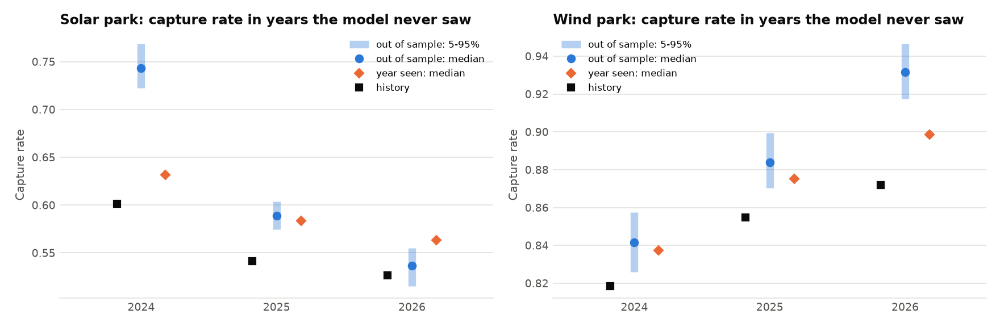

# Step 6 report: joint weather and price scenarios

Generated 2026-10-15 20:43 UTC by `ppa-lab scenarios`.

Data: CC BY 4.0 - Bundesnetzagentur | SMARD.de, via Energy-Charts (Fraunhofer ISE); ERA5 via Open-Meteo (CC BY 4.0 - Open-Meteo.com; contains modified Copernicus Climate Change Service information (ERA5)).

## 1. The weather-price link

The Step 5 model drew each simulated day at random from its season. Here the day's weather
decides: its level responds to the weather anomaly (regression per season on the solar and
wind capacity factors of the two parks and the temperature), and its hourly pattern comes
from one of the 10 historical days within ±30 days of the date whose
weather was closest (analog days). Calibration: 2024-01-01 to
2026-09-30, with the real weather of those days.

Response of the daily price level, in EUR/MWh at 140 EUR/MWh
(capacity factor CF: mean output / capacity):

| Season   |   R² |   +0.1 solar CF |   +0.1 wind CF |   +1 °C |
|:---------|-----:|----------------:|---------------:|--------:|
| autumn   | 0.69 |            -1.2 |          -16   |    -1.3 |
| spring   | 0.49 |           -17.1 |          -13.9 |    -1.7 |
| summer   | 0.47 |            -9.5 |          -14.3 |     1.5 |
| winter   | 0.64 |            -6.2 |          -12.3 |    -2.4 |

What weather does not explain still reverts with phi = 0.374 per day (half-life
0.70 days). Analog pool: 998 historical days.

## 2. Validation with the real weather of the calibration window

200 paths each; analog days at least 7 days away from the
simulated day (no peeking). Statistics with history inside the 5-95% range of the paths:
**Step 5: 7 of 11; Step 6:
8 of 11.**

| Statistic                 | History   | Step 5 (independent) (inside?)   | Step 6 (linked) (inside?)   |
|:--------------------------|:----------|:---------------------------------|:----------------------------|
| Mean (EUR/MWh)            | 90.4      | 91.1 (yes)                       | 90.9 (yes)                  |
| Standard deviation        | 57.6      | 55.9 (yes)                       | 56.1 (yes)                  |
| 1% quantile               | -20.1     | -18.4 (yes)                      | -19.9 (yes)                 |
| 5% quantile               | -0.1      | -1.4 (no)                        | -2.2 (no)                   |
| Median                    | 91.4      | 89.8 (yes)                       | 91.0 (yes)                  |
| 95% quantile              | 173.7     | 179.6 (no)                       | 178.5 (no)                  |
| 99% quantile              | 246.8     | 246.4 (yes)                      | 242.8 (yes)                 |
| Share of negative hours   | 6.2%      | 5.9% (yes)                       | 6.5% (yes)                  |
| Autocorrelation, 1 hour   | 0.921     | 0.916 (no)                       | 0.918 (yes)                 |
| Autocorrelation, 24 hours | 0.700     | 0.607 (no)                       | 0.635 (no)                  |
| Autocorrelation, 1 week   | 0.548     | 0.527 (yes)                      | 0.548 (yes)                 |

Capture rates of the parks in each complete year (median and 5-95% over paths):

|   Year | Park       |   History | Step 5 (independent)   | Step 6 (linked)     |
|-------:|:-----------|----------:|:-----------------------|:--------------------|
|   2024 | Solar park |     0.601 | 0.653 (0.616-0.692)    | 0.614 (0.588-0.647) |
|   2024 | Wind park  |     0.818 | 1.008 (0.980-1.042)    | 0.848 (0.831-0.865) |
|   2025 | Solar park |     0.542 | 0.609 (0.581-0.636)    | 0.571 (0.550-0.595) |
|   2025 | Wind park  |     0.855 | 1.037 (1.012-1.064)    | 0.874 (0.858-0.887) |

History outside the Step 6 range: wind park 2024 (0.818 vs 0.831-0.865), solar park 2025 (0.542 vs 0.550-0.595), wind park 2025 (0.855 vs 0.858-0.887).

## 3. The negative tail

In the calibration window 65% of the negative hours lie between −5 and 0 EUR/MWh: prices bunch just below zero, where flexible plants stop producing. A symmetric transform spreads that bunch into a deep tail. Negative prices can have their own scale b, y = −a arcsinh(|P| / b), with a chosen so that −500 EUR/MWh maps where it does with b = s = 120. In-sample, with the real weather (200 paths, analog days at least 7 days away):

|                     | 1% quantile (EUR/MWh)   | Negative hours   | Solar output at negative prices   |   Solar capture rate | Largest error of the first three   |
|:--------------------|:------------------------|:-----------------|:----------------------------------|---------------------:|:-----------------------------------|
| History             | −20.1                   | 6.2%             | 21.8%                             |                0.56  | –                                  |
| b = 120 (symmetric) | −42.8                   | 5.3%             | 16.9%                             |                0.571 | 113%                               |
| b = 40              | −28.5                   | 5.9%             | 18.8%                             |                0.581 | 42%                                |
| b = 15 (configured) | −19.9                   | 6.5%             | 21.0%                             |                0.587 | 4%                                 |
| b = 5               | −14.1                   | 7.3%             | 23.5%                             |                0.59  | 30%                                |

Configured: b = 15, the candidate with the smallest largest error. A realistic tail raises the solar capture rate a little: the deep negative tail had been hiding midday dips that are not deep enough (section 4).

## 4. Out of sample: years the model never saw

For each test year the model and the link are fitted on the days from 2023-01-01 up to the day before it, with analog days from its last 12 months (as for 2027). The year is then simulated with its real weather and each quarter at its realised average price: a perfect forward, so the test is about what the model adds (shape, tails, capture rates). Year seen: the same with the test year in the fit and in the analog pool (analog days at least 7 days away), which leaves only the model's structural error. 200 paths each.

History / model mean:

| Test year                       | Inside 5-95%                  | Std         | 1% quantile   | 5% quantile   | Negative hours   | Autocorrelation 24 h   |
|:--------------------------------|:------------------------------|:------------|:--------------|:--------------|:-----------------|:-----------------------|
| 2024 (2024-01-01 to 2024-12-31) | 4 of 11 (without the trend 4) | 52.7 / 44.0 | −20.0 / −11.8 | −0.0 / 0.9    | 5.2% / 5.0%      | 0.64 / 0.56            |
| 2025 (2025-01-01 to 2025-12-31) | 7 of 11 (without the trend 4) | 52.1 / 52.2 | −18.9 / −18.3 | −0.1 / −1.2   | 6.6% / 5.8%      | 0.70 / 0.64            |
| 2026 (2026-01-01 to 2026-09-30) | 5 of 11 (without the trend 4) | 65.9 / 61.3 | −26.2 / −23.9 | −0.2 / −2.2   | 7.2% / 6.3%      | 0.71 / 0.69            |

|   Year | Park       |   Capture rate: history | out of sample (5-95%)   |   without the build-out trend |   year seen | Output at negative prices: history / model   |
|-------:|:-----------|------------------------:|:------------------------|------------------------------:|------------:|:---------------------------------------------|
|   2024 | Solar park |                   0.601 | 0.743 (0.723-0.769)     |                         0.743 |       0.631 | 18.1% / 12.0%                                |
|   2024 | Wind park  |                   0.818 | 0.842 (0.826-0.858)     |                         0.842 |       0.837 | 7.1% / 8.0%                                  |
|   2025 | Solar park |                   0.542 | 0.589 (0.574-0.604)     |                         0.675 |       0.584 | 23.6% / 20.6%                                |
|   2025 | Wind park  |                   0.855 | 0.884 (0.870-0.899)     |                         0.878 |       0.875 | 8.2% / 6.6%                                  |
|   2026 | Solar park |                   0.526 | 0.537 (0.515-0.555)     |                         0.619 |       0.563 | 23.5% / 20.9%                                |
|   2026 | Wind park  |                   0.872 | 0.932 (0.918-0.947)     |                         0.923 |       0.899 | 8.9% / 6.1%                                  |

Out of sample the model's capture-rate error averages +0.066 for the solar park (+0.010 to +0.142) and +0.037 for the wind park (+0.023 to +0.060); with the year seen it is +0.036 and +0.022. Solar's midday dips deepen every year as capacity grows, and analog days from the past cannot know that. Since v1.7 each analog day's intraday pattern is moved to the simulated day by the trend per year of the hourly shape (same calendar month in different years); without it the errors were +0.123 and +0.033. Deeper midday dips raise the other hours a little, so the wind park's error grows slightly. The first test year has only one year to fit on, so no trend. The 2027 scenarios are fitted like the test years 2025, 2026, whose mean error (+0.029 and +0.044) Step 7 prices as a sensitivity.

## 5. Delivery year 2027: 496 scenarios

31 weather years (1995-2025) x 16 price paths
= 496 scenarios; forward 140.2 EUR/MWh with each quarter at the market's seasonal shape (Q1-Q4: 185.3 / 117.7 / 124.3 / 134.3 EUR/MWh, quotes of 2026-09-14), level uncertainty
0.12. The same scenarios with prices independent of the weather
(Step 5 model) for comparison.

| Park       | Prices      |   Fair PaP price (EUR/MWh) | Capture rate 5/50/95%   | Revenue P10/P50/P90 (EUR m)   |   Corr(energy, baseload price) |
|:-----------|:------------|---------------------------:|:------------------------|:------------------------------|-------------------------------:|
| Solar park | independent |                      79.78 | 0.501 / 0.563 / 0.615   | 6.98 / 9.49 / 12.32           |                           0.01 |
| Solar park | linked      |                      77.47 | 0.481 / 0.546 / 0.602   | 6.88 / 9.26 / 12.16           |                           0.02 |
| Wind park  | independent |                     149.51 | 1.023 / 1.059 / 1.099   | 7.54 / 9.49 / 11.74           |                          -0.01 |
| Wind park  | linked      |                     130.56 | 0.882 / 0.930 / 0.962   | 6.60 / 8.27 / 10.31           |                          -0.16 |

- Ignoring the weather link overstates the fair pay-as-produced price by
  2.31 EUR/MWh (solar park) and 18.95 EUR/MWh (wind park).
- Monte Carlo standard error of the linked fair prices:
  solar park 0.77 EUR/MWh, wind park 1.00 EUR/MWh.
- Does the latest historical capture rate fall inside the linked range?
  Solar park: 2025 history 0.542, linked 5-95% 0.481 to 0.602 (inside); Wind park: 2025 history 0.855, linked 5-95% 0.882 to 0.962 (outside). The comparison mixes in the price level: 2027 is simulated at 140 EUR/MWh, 2025 averaged 89, and in this model the capture rate rises with the level (Step 7 shows the sensitivity); the validation above is the test.

Per-scenario results: `data/processed/scenarios_2027.parquet` (input for Step 7).

### Sensitivity: which historical days represent 2027?

Intraday patterns come from the analog pool. Midday solar dips deepened year by year as
solar capacity grew, so the pool's period matters. The base case above uses the whole
calibration window (as in the validation).

| Analog days from            |   Days in pool |   Solar park: fair price |   Solar park: median capture rate |   Wind park: fair price |   Wind park: median capture rate |
|:----------------------------|---------------:|-------------------------:|----------------------------------:|------------------------:|---------------------------------:|
| 2024-01-01 (whole window)   |            998 |                    77.47 |                             0.546 |                  130.56 |                            0.93  |
| 2025-01-01 (2025 onward)    |            635 |                    77.17 |                             0.545 |                  130.5  |                            0.931 |
| 2025-10-01 (last 12 months) |            363 |                    77.53 |                             0.546 |                  129.94 |                            0.925 |

## 6. Charts

