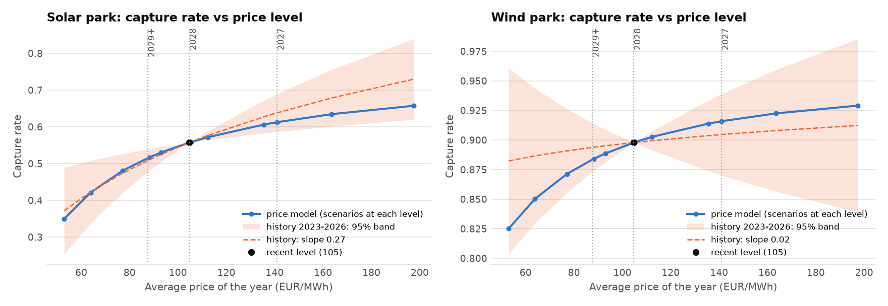
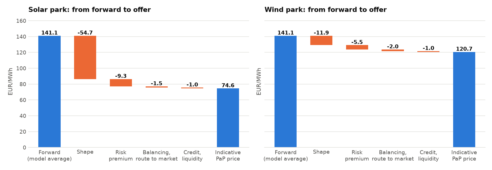
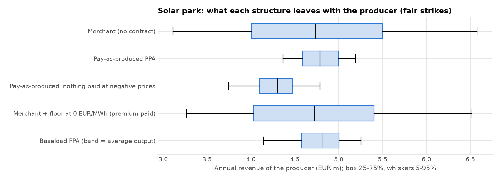
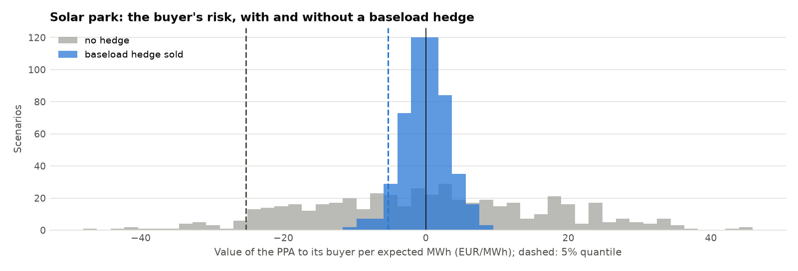

# Step 7 report: pricing the PPAs and their risk

Generated 2026-10-16 06:49 UTC by `ppa-lab pricing`.

Inputs: the Step 6 joint scenarios for 2027
(496 scenarios: 31 weather years x
16 price paths), with intraday patterns from analog days
from **2025-10-01** on (the most recent regime; the whole window is a sensitivity).
Forward: EEX German Power Cal-27 base 140.21 EUR/MWh (quote of 2026-10-09, via tacto.ai); its quarters follow the market's seasonal shape (Q1-Q4 185.3 / 117.7 / 124.3 / 134.3, quotes of 2026-09-14); later years follow the forward curve (2028: 104.75, 2029: 87.58), held flat after 2029. The scenarios average
141.06 EUR/MWh in 2027. Risk measures at the 5% quantile.

## 1. What each structure leaves with the producer (2027)

All structures struck at their own fair price. A park that sells at spot, or is not paid at negative prices, stops producing below 0 EUR/MWh, so those structures earn more on average by the value of curtailing (section 5); the plain PPA and the merchant that keeps producing forgo it. The spread of annual revenue is
what changes most: the 95% cash flow at risk.

| Park       | Structure                                                  | Strike (EUR/MWh)   | Output sold or paid   |   Expected revenue (EUR m) |   P5 revenue (EUR m) |   Cash flow at risk 95% (EUR m) | CFaR / expected   |
|:-----------|:-----------------------------------------------------------|:-------------------|:----------------------|---------------------------:|---------------------:|--------------------------------:|:------------------|
| Solar park | Merchant (no contract), curtailing at negative prices      | spot               | 82%                   |                       9.71 |                 6.69 |                            3.02 | 31%               |
| Solar park | Merchant, producing at negative prices                     | spot               | 100%                  |                       9.34 |                 6.09 |                            3.24 | 35%               |
| Solar park | Pay-as-produced PPA                                        | 77.53              | 100%                  |                       9.34 |                 8.64 |                            0.7  | 7%                |
| Solar park | Pay-as-produced, negative-price clause (curtailed, unpaid) | 97.76              | 82%                   |                       9.71 |                 8.42 |                            1.29 | 13%               |
| Solar park | Pay-as-produced, buyer curtails and pays the output        | 80.63              | 100%                  |                       9.71 |                 8.98 |                            0.73 | 7%                |
| Solar park | Baseload PPA (band = average output)                       | 141.06             | 82%                   |                       9.71 |                 8.11 |                            1.6  | 16%               |
| Wind park  | Merchant (no contract), curtailing at negative prices      | spot               | 96%                   |                       8.35 |                 6.25 |                            2.1  | 25%               |
| Wind park  | Merchant, producing at negative prices                     | spot               | 100%                  |                       8.31 |                 6.18 |                            2.13 | 26%               |
| Wind park  | Pay-as-produced PPA                                        | 129.94             | 100%                  |                       8.31 |                 7.34 |                            0.96 | 12%               |
| Wind park  | Pay-as-produced, negative-price clause (curtailed, unpaid) | 136.66             | 96%                   |                       8.35 |                 7.37 |                            0.98 | 12%               |
| Wind park  | Pay-as-produced, buyer curtails and pays the output        | 130.63             | 100%                  |                       8.35 |                 7.38 |                            0.97 | 12%               |
| Wind park  | Baseload PPA (band = average output)                       | 141.06             | 96%                   |                       8.35 |                 7.24 |                            1.11 | 13%               |

## 2. The buyer's risk premium

The buyer of a pay-as-produced PPA takes every MWh at the strike and sells it at spot. It
hedges the price level by selling a baseload band of the expected average output at the
forward; what is left is profile and volume risk. Premium = (expected value − 5% quantile)
per expected MWh.

| Park       |   Fair price |   Premium, no hedge |   Premium after baseload hedge |   of which profile |   of which volume (and its link to price) |
|:-----------|-------------:|--------------------:|-------------------------------:|-------------------:|------------------------------------------:|
| Solar park |        77.53 |               25.44 |                          10.54 |              10.11 |                                      0.43 |
| Wind park  |       129.94 |               34.81 |                           5.49 |               1.95 |                                      3.55 |

## 3. Price stack 2027: from the forward to an indicative price

| Layer (EUR/MWh)                        |   Solar park |   Wind park |
|:---------------------------------------|-------------:|------------:|
| Forward (model average baseload price) |       141.06 |      141.06 |
| Shape: capture rate below 1            |       -63.54 |      -11.12 |
| = Fair pay-as-produced price           |        77.53 |      129.94 |
| − Profile and volume risk premium      |        10.54 |        5.49 |
| − Balancing and route to market        |         1.5  |        2    |
| − Credit and liquidity                 |         1    |        1    |
| = Indicative pay-as-produced price     |        64.48 |      121.45 |

Balancing and credit costs are stated assumptions (`[ppa.parks.*]` in `config/project.toml`).

## 4. 10-year price (2027-2036)

Discounted at 6% (mid-year), energy-weighted; forwards as above. Capture-rate
trend per year after 2027 (base case): solar park -1 pp, wind park +0 pp; solar output degrades
0.5% per year. The risk premium and costs per MWh of the first year
are applied to every year (a simplification).

| Case                                              |   Solar park: fair |   Solar park: indicative |   Wind park: fair |   Wind park: indicative |
|:--------------------------------------------------|-------------------:|-------------------------:|------------------:|------------------------:|
| Base case                                         |              41.15 |                    28.1  |             86.64 |                   78.15 |
| Capture-rate trend 2 pp/yr steeper                |              34.13 |                    21.09 |             79.55 |                   71.06 |
| Capture-rate trend 1 pp/yr steeper                |              37.64 |                    24.6  |             83.09 |                   74.6  |
| Capture-rate trend 1 pp/yr flatter                |              44.65 |                    31.61 |             90.18 |                   81.69 |
| Forward −10%                                      |              34.29 |                    21.25 |             77.22 |                   68.73 |
| Forward +10%                                      |              47.92 |                    34.88 |             96.02 |                   87.53 |
| Analog days from the whole window                 |              41.11 |                    28.07 |             87.06 |                   78.57 |
| Capture rate vs price level: low end of history   |              42.62 |                    29.58 |             87.83 |                   79.33 |
| Capture rate vs price level: high end of history  |              40.49 |                    27.45 |             86.36 |                   77.87 |
| Capture rate less the model's out-of-sample error |              38.37 |                    25.33 |             82.35 |                   73.86 |

Each year's capture rate moves with that year's forward along the model's own response to the price level (section 5), on top of the trend. The two rows on the capture rate vs price level use history's 95% interval for that slope instead, from the recent level (105 EUR/MWh): a flatter slope gives a lower capture rate at the high 2027 forward but a higher one once the curve falls below the recent level. The last row takes the model's mean out-of-sample capture-rate error off every year (solar park +0.029, wind park +0.044; test years 2025, 2026, fitted like 2027; Step 6, section 4): fitted on the years before, the model overstated capture rates even with the price level given. The 2027 scenarios carry history's build-out trend up to 2027 (Step 6, section 4); continued for one more year at the same forward it would move the capture rate by solar park −5.6 pp, wind park +0.3 pp. The base case assumes solar park -1 pp, wind park +0 pp a year after that: storage, flexible demand and curtailment are expected to slow the fall, and a straight line would take solar's capture rate towards zero within a decade (the −2 pp row is the steeper view).

## 5. Negative prices: curtail, and who keeps the value

In hours with negative prices output is worth less than nothing. A park that sells at spot stops producing then: its marginal cost is about zero, and no subsidy is paid at negative prices (§51 EEG). Under a plain pay-as-produced PPA it is paid the strike for every MWh, so it keeps producing and the buyer sells that output at a loss: the value of curtailing is lost to both sides. Three ways to handle it:

- **Plain PPA** (the base case above): nobody curtails; the fair price includes the negative hours.
- **Negative-price clause**: nothing is paid at negative prices and the park curtails. The strike is the fair price of the output delivered, higher per MWh, and the park keeps the value of curtailing, but it takes back volume risk: sunny, cheap years have more negative hours.
- **Deemed output**: the buyer may curtail and pays the curtailed output as if produced. The strike rises by the value of curtailing; the producer's risk stays that of the plain PPA.

| EUR/MWh | Solar park | Wind park |
|---|---|---|
| Output at negative prices, 2027 | 17.5% | 4.4% |
| Their output-weighted mean price | −17.70 | −15.63 |
| Saved by curtailing, per MWh of output | 3.10 | 0.69 |
| Plain PPA: fair price 2027; 10-year indicative | 77.53; 28.10 | 129.94; 78.15 |
| Clause: fair price 2027 per delivered MWh | 97.76 | 136.66 |
| Clause: buyer's premium after a baseload hedge | 14.56 (plain 10.54) | 5.93 (plain 5.49) |
| Clause: 10-year fair; indicative, per delivered MWh | 69.97; 52.92 | 97.00; 88.07 |
| Clause: 10-year indicative per MWh of output (delivered share) | 36.75 (69.5%) | 80.03 (90.9%) |
| Deemed output: fair price 2027 | 80.63 | 130.63 |
| Producer's CFaR95 2027: plain; clause (EUR m) | 0.70; 1.29 | 0.96; 0.98 |

The clause's tenor price follows the curtailed output's capture rate and its delivered share at each year's forward (more negative hours at lower forwards), plus the capture-rate trend; the first year's premium and costs apply to every year. In history the parks' output at negative prices grew with the build-out:

| Year | Solar park: output at negative prices; saved per MWh | Wind park: output at negative prices; saved per MWh |
|---|---|---|
| 2021 | 4.1%; 0.93 | 4.0%; 0.67 |
| 2022 | 1.6%; 0.06 | 1.9%; 0.03 |
| 2023 | 7.7%; 1.84 | 6.3%; 0.73 |
| 2024 | 18.1%; 2.86 | 7.1%; 0.75 |
| 2025 | 23.6%; 3.38 | 8.2%; 0.53 |
| 2026 | 23.5%; 4.93 | 8.9%; 1.08 |

2026: January to September. Out of sample (Step 6, section 4) the model put the solar park's output at negative prices 3 percentage points below history, so these values are if anything low.

## 6. The EEG premium against a PPA

### Wind park

The wind park is paid under the EEG market premium model: it sells at spot and the grid operator adds max(AW − MW, 0) per MWh, MW the month's official onshore wind market value. That is a strip of puts on the market value, struck at the award value AW, here **77 EUR/MWh (an assumption: the award is not published; see `[eeg]`)**. To sign a PPA the park would leave the premium (a PPA buyer wants the guarantees of origin, which the EEG does not issue), so the PPA must be worth more than the EEG. MW in a scenario: the park's own capture price that month times 0.968, the ratio of the official value to the park's capture price in 44 months from 2023-01 (sd 0.042). No premium at negative prices (§51 EEG; the park curtails).

Per MWh of output (EUR/MWh):

| Year | Forward | Merchant | Market premium | Under the EEG |
|---|---|---|---|---|
| 2027 | 141.1 | 130.6 | 0.49 | 131.1 |
| 2028 | 104.8 | 95.9 | 4.11 | 100.0 |
| 2029-2036 | 87.6 | 79.6 | 8.88 | 88.5 |

Over 10 years (discounted, energy-weighted) the EEG pays 95.4 EUR/MWh, of which 7.23 premium; after the direct marketer's fee (2.0) **93.4**. A PPA pays 86.6 at its fair price and **78.1** at the indicative price: 15.2 EUR/MWh less than staying in the EEG. The put is worth little at the 2027 forward but much at the lower forwards of later years.

Risk in one delivery year, at two price levels:

| Price level | CFaR95, EUR m: merchant / EEG / PPA | 5% quantile, EUR/MWh: merchant / EEG / PPA |
|---|---|---|
| 2027 forward (140) | 2.10 / 2.03 / 0.96 | 97.8 / 99.4 / 114.9 |
| lowest quoted forward (88) | 1.58 / 0.99 / 0.58 | 55.4 / 73.4 / 69.4 |

The put cuts the merchant's risk most where prices are low, and a PPA removes more of it; but at the lowest forward the EEG's bad year is better than the PPA's (73.4 against 69.4 EUR/MWh): the put floors the price and the EEG keeps the upside. By award value:

| Award value AW (EUR/MWh) | Market premium, ten years | Under the EEG, after the fee |
|---|---|---|
| 60 | 2.30 | 88.4 |
| 70 | 4.76 | 90.9 |
| 77 (assumed) | 7.23 | 93.4 |
| 85 | 10.77 | 96.9 |
| 95 | 16.26 | 102.4 |
| 77, yearly market value | 5.14 | 91.3 |

For every award value in the range the EEG pays more than a PPA at the indicative price (by 10.3 EUR/MWh even at AW 60). Leaving the EEG for a PPA pays only at a price of at least about 93 EUR/MWh, less what the producer would pay to be rid of the remaining risk, plus the guarantees of origin it could then sell. The PPA price of section 4 is a what-if for this park.

## 7. Does the capture rate rise with the price level?

The price model shifts all hours together in arcsinh units, so a higher price level lifts the hours near zero and solar's capture rate rises with it. The usual shape-factor view scales all hours instead, and the capture rate stays put. The 2027 forward (141 EUR/MWh) lies above the recent level (105) and the curve falls to 88, so the answer moves the price.

History decides: monthly capture rates regressed on ln(average price), with month effects and the technology's share of load (its build-out) held fixed; HC1 standard errors (`analysis/level_effect.py`). The model's slope comes from rebuilding the scenarios at each forward with the same random draws.

| Change of capture rate per unit of ln(price) | Solar park | Wind park |
|---|---|---|
| History 2023-2026: slope (95% interval) | 0.27 (0.10 to 0.45) | 0.02 (−0.09 to 0.14) |
| t-statistic; months | 3.1; 45 | 0.4; 45 |
| History 2021-2026, all years | 0.10 (0.06 to 0.13) | 0.00 (−0.04 to 0.04) |
| Model: recent level (105) to forward 2027 | 0.22 | 0.06 |
| Model: over the tenor's forwards (88 to 141) | 0.24 | 0.07 |

**Solar park**: the capture rate rises with the price level (slope 0.27, t = 3.1), so the shape-factor view (slope 0) is rejected; the model's 0.22 lies inside the 95% interval. **Wind park**: history cannot tell the slope from zero (0.02, t = 0.4); the model's 0.06 lies inside the 95% interval.

Build-out, from the same regression at a fixed price level: solar park −2.90 per unit of its share of load, which grew 1.3 pp a year in 2022-2025: −3.7 pp of capture rate a year (base-case trend −1 pp); wind park −0.36 per unit of its share of load, which grew 0.8 pp a year in 2022-2025: −0.3 pp of capture rate a year (base-case trend +0 pp). The trend assumes that storage, flexible demand and curtailment slow solar's fall; the −2 pp row of section 4 is closer to history's pace.

So the base case moves each year's capture rate along the model's response (chart below); holding the first year's capture rate over the tenor instead (as before v1.5) would give fair prices of solar park 49.6, wind park 88.9 EUR/MWh.

## 8. The answer

For a 10-year pay-as-produced PPA (2027-2036) from the solar park, the fair price before risk premia is **41.1 EUR/MWh** (first year: forward 141.1 × expected capture rate 0.55 = 77.5). After a profile and volume risk premium of 10.5 EUR/MWh and balancing and credit costs of 2.5 EUR/MWh, the indicative price is **28.1 EUR/MWh**. Expected annual energy is 120.9 GWh (P50; one-year P90 113.4 GWh). Under the PPA the producer's 95% cash flow at risk falls from EUR 3.02 m (merchant) to EUR 0.70 m per year: only volume risk is left.

## 9. Charts

Results for Step 9: `data/processed/ppa_pricing.json`.
