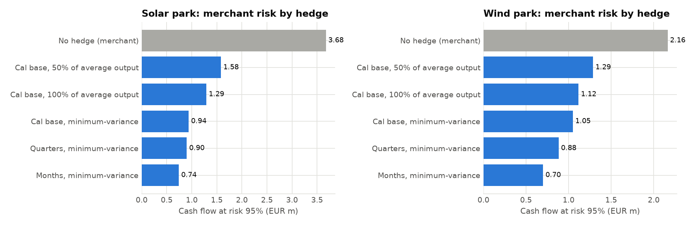
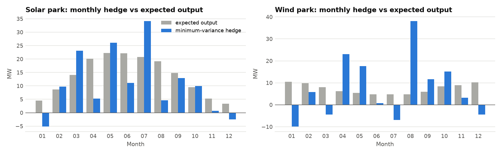
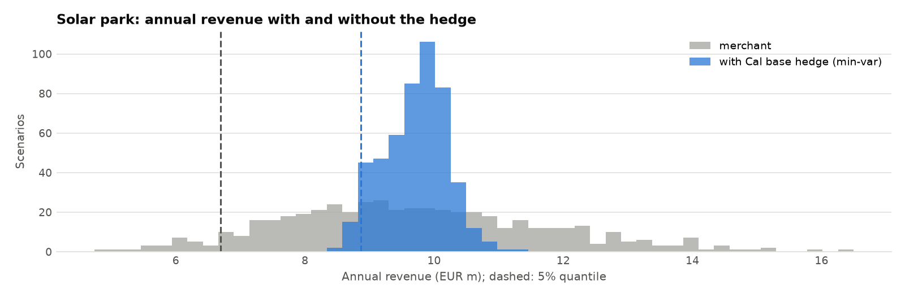

# Step 8 report: hedging with power futures

Generated 2026-10-16 07:39 UTC by `ppa-lab hedging`.

Inputs: the Step 7 scenarios for 2027 (496 scenarios,
analog days from 2025-10-01). Selling a product at its forward pays, per MW,
the sum over its hours of (forward − spot). Forwards below are the model's expected prices,
so every hedge is fair in expectation and only changes the spread.

## 1. The forward curve

| Product   |   Model forward (EUR/MWh) |
|:----------|--------------------------:|
| Cal base  |                    141.06 |
| Cal peak  |                    135.64 |
| Q1        |                    186.35 |
| Q2        |                    118.5  |
| Q3        |                    125.06 |
| Q4        |                    135.12 |

### Market check

| Product   |   Market quote (EUR/MWh) | Quote date   |   Model forward (EUR/MWh) |   Market − model | Source                                                                           |
|:----------|-------------------------:|:-------------|--------------------------:|-----------------:|:---------------------------------------------------------------------------------|
| cal_base  |                   104.24 | 2026-07-31   |                    141.06 |           -36.82 | [link](https://www.tacto.ai/en/energy/electricity-price) (www.tacto.ai)          |
| cal_base  |                   113.45 | 2026-08-28   |                    141.06 |           -27.61 | [link](https://www.power2market.com/en/markets) (www.power2market.com)           |
| cal_base  |                   135.8  | 2026-09-14   |                    141.06 |            -5.26 | [link](https://www.power2market.com/de/markets/de/termin) (www.power2market.com) |
| cal_base  |                   126.47 | 2026-09-29   |                    141.06 |           -14.59 | [link](https://www.tacto.ai/en/energy/electricity-price) (www.tacto.ai)          |
| cal_base  |                   140.21 | 2026-10-09   |                    141.06 |            -0.85 | [link](https://www.tacto.ai/en/energy/electricity-price) (www.tacto.ai)          |

The model's forward is the market: EEX German Power Cal-27 base 140.21 EUR/MWh (quote of 2026-10-09, via tacto.ai); its quarters follow the market's seasonal shape (Q1-Q4 185.3 / 117.7 / 124.3 / 134.3, quotes of 2026-09-14); later years follow the forward curve (2028: 104.75, 2029: 87.58), held flat after 2029. The quotes show how fast the level moves: between 104.24 and 140.21 EUR/MWh from 2026-07-31 to 2026-10-09. A 10% move of the whole curve changes the solar park's ten-year indicative price by 6.8 EUR/MWh (Step 7), so an offer must be refreshed with the curve on the day of signing.

## 2. Hedging merchant output

What each park's revenue risk would be if it sold at spot, and with each hedge. Selling at spot,
a park stops producing at negative prices (Step 7, section 5). Hedge ratio = MW sold / average
output sold in MW.

| Park       | Strategy                         |   Sold (MW, year average) | Hedge ratio   |   CFaR95 (EUR m) | CFaR reduction   | Variance removed   |
|:-----------|:---------------------------------|--------------------------:|:--------------|-----------------:|:-----------------|:-------------------|
| Solar park | No hedge (merchant)              |                       0   | 0%            |             3.02 | 0%               | 0%                 |
| Solar park | Cal base, 50% of average output  |                       5.7 | 50%           |             1.37 | 55%              | 77%                |
| Solar park | Cal base, 100% of average output |                      11.3 | 100%          |             1.04 | 66%              | 92%                |
| Solar park | Cal base, minimum-variance       |                       9.8 | 87%           |             0.84 | 72%              | 94%                |
| Solar park | Quarters, minimum-variance       |                       9.8 | 86%           |             0.81 | 73%              | 95%                |
| Solar park | Months, minimum-variance         |                      10.1 | 89%           |             0.67 | 78%              | 96%                |
| Wind park  | No hedge (merchant)              |                       0   | 0%            |             2.1  | 0%               | 0%                 |
| Wind park  | Cal base, 50% of average output  |                       3.5 | 50%           |             1.3  | 38%              | 65%                |
| Wind park  | Cal base, 100% of average output |                       7   | 100%          |             1.07 | 49%              | 82%                |
| Wind park  | Cal base, minimum-variance       |                       6.5 | 93%           |             1.05 | 50%              | 82%                |
| Wind park  | Quarters, minimum-variance       |                       7.3 | 104%          |             0.9  | 57%              | 86%                |
| Wind park  | Months, minimum-variance         |                       7.4 | 105%          |             0.7  | 67%              | 90%                |

For the solar park, the minimum-variance Cal base hedge sells
9.8 MW (87% of average output) and cuts the cash flow
at risk by 72%; quarters and months add little, and
their monthly amounts are noisy (some even negative): with 496 scenarios the
finer split mostly fits noise.

## 3. The PPA buyer's hedge

Step 7 assumed the buyer sells a band equal to the average output. The minimum-variance band
is smaller, because the parks produce more in cheap hours than a flat band:

| Park       |   Full band (MW) |   Premium, full band | Minimum-variance band (MW)   |   Premium, min-var band |
|:-----------|-----------------:|---------------------:|:-----------------------------|------------------------:|
| Solar park |            13.75 |                10.54 | 10.37 (75%)                  |                    4.79 |
| Wind park  |             7.3  |                 5.49 | 6.99 (96%)                   |                    5.37 |

## 4. Back-test on history

Cal base sold for year Y at year Y-1's average spot price (a naive forward proxy), at the
minimum-variance ratio of the P50 average output; real futures quotes would replace the proxy.

| Park       |   Year |   Forward proxy (EUR/MWh) |   Realised base (EUR/MWh) |   Merchant (EUR m) |   Hedge P&L (EUR m) |   Hedged (EUR m) |
|:-----------|-------:|--------------------------:|--------------------------:|-------------------:|--------------------:|-----------------:|
| Solar park |   2024 |                     95.18 |                     78.51 |               5.69 |                1.75 |             7.45 |
| Solar park |   2025 |                     78.51 |                     89.32 |               6.15 |               -1.13 |             5.02 |
| Wind park  |   2024 |                     95.18 |                     78.51 |               4.15 |                0.99 |             5.14 |
| Wind park  |   2025 |                     78.51 |                     89.32 |               4.46 |               -0.64 |             3.82 |

Across the back-test years, solar park: merchant revenue moved by EUR 0.46 m between the years, hedged revenue by EUR 2.43 m; wind park: merchant revenue moved by EUR 0.31 m between the years, hedged revenue by EUR 1.32 m. A hedge can lose money in a single year,
and with a naive forward (last year's price) it can even add variation, because the proxy moves
against the realised price. Two years are an illustration, not evidence: the scenario results
in section 2 measure the risk.

## 5. Charts

Results for the memo and the dashboard: `data/processed/hedging.json`.
